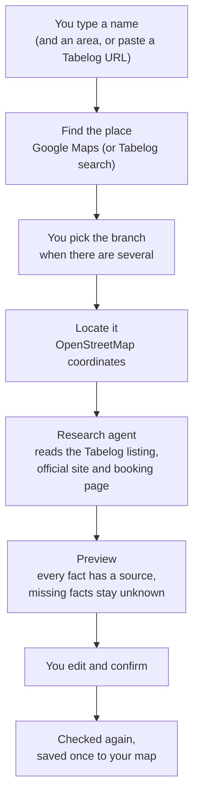
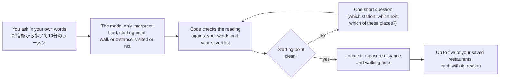

# Place Atlas

**Japan Atlas 0.1.0** — a quiet, self-hosted map and journal of the restaurants you find, in Japan. You run it on your own Cloudflare account, so your records, photos and keys stay with you.

## Why

Restaurants turn up everywhere: an Instagram reel, a RED (Xiaohongshu) post, a YouTube video, a friend's message. Collecting them by hand into map lists is tedious, and Google Maps lists cannot be filled in by an AI agent. Writing down what you thought means public reviews that everyone can read.

Place Atlas is one place that gathers them for you and keeps them private:

- **Add by a few words.** Type a name, or a name and area, roughly as you saw it. An agent finds the exact branch, then looks up its Tabelog score, opening hours, reservation rule, cuisine and links, and puts it on your map after you review it.
- **Your own notes, not public reviews.** Scores, comments, favorites and a journal of every visit with photos and videos, visible on your own site.
- **Ask your own list.** "Ramen within a 10-minute walk of Shinjuku Station I haven't been to" is answered from the restaurants you saved, not from the whole internet.

Visitors to your site can browse what you publish; only you, the Owner, can change anything.

## Features

### Add a restaurant



| | How it works |
| --- | --- |
| **What you type** | A name as you remember it, optionally with an area or branch (`一蘭 渋谷`, `Afuri Ebisu`), or a pasted Tabelog listing URL. Japanese, English and mixed input work; dictated text is tolerated. |
| **Finding the place** | With a Google Places key, the name is checked against Google Maps and up to three Japanese candidates are shown with their address. Without one, Tabelog listings are found through web search. A pasted Tabelog URL is read directly. |
| **What is added** | Name, address and map coordinates; Tabelog score and listing link; cuisine categories and signature dishes; opening hours and closing days; the dine-in reservation rule (reservable, required, not taken) with the booking link and how far ahead bookings open; the official website; a Google rating as a dated reference (optional). |
| **How facts are checked** | The agent works within a fixed budget (two searches, three model turns, 35 seconds). A fact is kept only when it is quoted from a source about the same branch: the same name, street number, postcode and town, or the same map pin. A takeaway note never decides the dine-in rule. Anything it cannot prove stays *unknown* and you can fill it in. |
| **Review before saving** | The preview shows every field with its source. You can edit the name, address, coordinates, notes and any fact, and see possible duplicates of places you already saved. |
| **Saving** | Confirm re-checks the place, its location and its sources. If something changed, you see the new preview first. A restaurant without a name, address and coordinates is never saved, and pressing Confirm twice saves it once. |
| **When something fails** | Each warning names what happened: Google or search refused or unavailable, Tabelog refused the read, no listing matched this branch, or research timed out. Your selection is kept, nothing is invented, and you can retry, paste the Tabelog URL, or complete the fields yourself. Without a model key, Add still finds and locates the place. |
| **From other tools** | An external agent (for example a chat bot) can add restaurants through the Add Agent API with its own token (`GET /api/agent/capabilities` describes it). It cannot set your personal fields. |

### Recommend from your own list



| | How it works |
| --- | --- |
| **What you can ask** | A dish or cuisine (ramen, sushi, French, 焼肉…), a starting point (an area, a station, an address, a saved restaurant or a Google Maps link), a walking time (*within 10 minutes*), *near me*, places you have or haven't visited, and walk-in only (*no reservation*). |
| **Where answers come from** | Only your saved restaurants. The model never invents a restaurant, a location or a route; a cuisine you have not saved returns no results instead of something unrelated. |
| **Distances and times** | Stations and addresses are geocoded and walking times come from Google through the optional route sidecar, shown with their source and time. Otherwise distance is straight-line. |
| **Clarifying questions** | An unclear starting point gets one short question: an exact point within a broad area, which of several matching places, or a choice of located candidates. |
| **Not supported yet** | Train and driving times (Google has no train routes in Japan; you are told so instead of getting a guess), and conditions on scores such as *Tabelog 3.5 or higher* (planned, see below). |

### Browse, journal and keep your own notes

| | What you get |
| --- | --- |
| **Map** | Every saved restaurant on an OpenStreetMap map, with a side list you can search by name, filter by visited/not visited and favorites, and sort by date added or score. |
| **Table** | All restaurants with cuisine, prefecture, area, Tabelog / Google / your scores, visits and reservation rule; filter by cuisine and prefecture, search, and sort by last visit, your rating, Tabelog, Google or name. |
| **Restaurant details** | Tabelog score and link, opening hours, closing days, reservation rule and booking link, official site, dishes, address and map, with each fact's source. |
| **Your notes** | A personal score from 0 to 10, a favorite (♡), visited or not, and an overall comment, all yours and editable any time. The Owner can also correct the name and description, refresh the Google rating, or delete a restaurant with its visits and photos. |
| **Journal** | Record each visit with a date, an optional note and score, and photos or videos. Browse all visits and sort or filter them by restaurant. |
| **Photos and videos** | JPEG/PNG/WebP/GIF up to 8 MB and MP4/WebM up to 50 MB, checked by file signature. Add a caption to any photo, browse them in a viewer, delete them individually. Uploads are safe to retry: a retry never duplicates or overwrites a file. |
| **Visitors and Owner** | Anyone with the link can browse published restaurants, visits and photos. Only the Owner (one password per deployment) can add, edit, upload or ask Recommend, which spend your provider quota. |
| **Your keys** | The Owner saves a model key (DeepSeek, OpenAI or any OpenAI-compatible API) on the site. It is encrypted at rest and never sent back to the browser. Monthly caps protect paid Google calls. |

## Deploy your own

Place Atlas 0.1.0 runs on **Cloudflare** (Workers, D1 and R2); other hosts are not supported yet. A personal deployment fits Cloudflare's free tiers.

### What only you can do

1. **GitHub**: fork or clone this repository.
2. **Cloudflare**: create an account, then in the dashboard open **R2** and enable it (Cloudflare asks for a payment method even for the free tier).
3. **Sign in** on your computer with `npx wrangler login` (it opens your browser). On the first deploy, Wrangler may ask you to choose your `workers.dev` subdomain.
4. **Choose** an Owner password, and get a model API key (for example from DeepSeek or OpenAI). Optional: a Google Maps Platform key and a Firecrawl key (see [Optional settings](#optional-settings)).

### With an AI coding agent

Open the repository in a coding agent such as Claude Code and ask:

> Deploy Place Atlas to my Cloudflare account by following "Deploy step by step" in README.md. I have already run `npx wrangler login`. Ask me for the Owner password when you need it.

The agent runs every step below, generates the session secret, writes your database ID into the local configuration, and stops only for the things above. Your password and keys go straight into Cloudflare as secrets; nothing is committed to the repository.

### Deploy step by step

You need Node.js 22.13 or newer.

```sh
git clone https://github.com/<you>/place-atlas.git
cd place-atlas/apps/web
npm ci
cp wrangler.jsonc wrangler.local.jsonc        # your deployment config (ignored by git)

npx wrangler d1 create place-atlas            # prints a database_id
# In wrangler.local.jsonc, replace 00000000-0000-4000-8000-000000000000 with that database_id.

npx wrangler r2 bucket create place-atlas-media
npx wrangler d1 migrations apply DB --remote --config wrangler.local.jsonc
npm run deploy                                # prints your site URL

npx wrangler secret put ATLAS_OWNER_PASSWORD --config wrangler.local.jsonc
openssl rand -hex 32 | npx wrangler secret put ATLAS_OWNER_SESSION_SECRET --config wrangler.local.jsonc
```

Open the printed URL, choose **Owner login**, then open **Model settings** and save your model's base URL, model name and key. The model powers the Add research agent and reads Recommend requests. Without it, Add still finds and locates places, and Recommend says it is unavailable.

To update later: `git pull`, `npm ci`, apply migrations again (`npx wrangler d1 migrations apply DB --remote --config wrangler.local.jsonc`), then `npm run deploy`.

### Optional settings

Set secrets with `npx wrangler secret put NAME --config wrangler.local.jsonc` and plain values under `vars` in `wrangler.local.jsonc`, then deploy again.

| Name | Purpose |
| --- | --- |
| `GOOGLE_PLACES_API_KEY` + `CATALOG_INTAKE_GOOGLE_PLACES_MODE=enabled` | Add checks the typed name against Google Maps, and the Owner can load Google ratings. Without it, Add searches Tabelog. Monthly request caps are kept in D1. |
| `FIRECRAWL_API_KEY` | Reads Tabelog through Firecrawl (`RESTAURANT_SOURCE_READER=firecrawl`, the default). Tabelog often refuses requests from Cloudflare directly, so this is recommended. |
| `CATALOG_INTAKE_DURABLE_GEOCODER_MODE=enabled` | Confirms coordinates with OpenStreetMap Nominatim (on by default; cached for 30 days). |
| `SEARCH_API_KEY` | Tavily web search for the research agent (otherwise public search pages are used). |
| `AGENT_API_KEY`, `AGENT_BASE_URL`, `AGENT_MODEL` | A server-managed model instead of the Owner's Model settings form. |
| `AGENT_SETTINGS_SECRET` | A separate 32+ character key for encrypting saved model keys (defaults to the session secret). |
| `ATLAS_ADD_AGENT_TOKEN` | A 32–128 character URL-safe Bearer token for the external Add Agent API. |
| `ATLAS_PUBLIC_URL` | Your site URL, sent to Nominatim as contact information. |
| `ROUTE_SIDECAR` service binding | Recommend from a station or address, with walking times (below). Without it, food and area requests still work. |

#### Route sidecar (optional)

A second, private Worker holds a Google Maps key for geocoding and walking times:

```sh
npx wrangler secret put GOOGLE_MAPS_API_KEY --config wrangler.route-sidecar.jsonc
npm run deploy:route-sidecar
```

Then add `"services": [{ "binding": "ROUTE_SIDECAR", "service": "japan-atlas-route-sidecar" }]` to `wrangler.local.jsonc` and run `npm run deploy` again.

### Upgrading from the preview build

Deployments of the October 2026 preview build need no data migration: this version reads the same D1 tables and both stored record formats, keeps sessions and saved model keys valid, and serves the same photo links. Back up first:

```sh
npx wrangler d1 export DB --remote --config wrangler.owner-poc.local.jsonc --output atlas-backup.sql
```

Your `wrangler.owner-poc.local.jsonc` keeps working (renaming it to `wrangler.local.jsonc` is optional): its old entry point is replaced at build time, and its variables, secrets, daily cleanup and route sidecar binding are used as before. The Add and Recommend endpoints keep their request and response formats. Event and architecture records are no longer shown but stay in the database, and the in-browser (WebMCP) tools were replaced by the Add Agent API.

## Next

Planned for the next version:

- **Recommend with conditions on your data.** Requests such as *a place I have never visited near Ginza* or *ramen with a score above 3.5* (in Japan, usually the Tabelog score) become explicit conditions that code checks against each saved restaurant before anything is returned. A model only translates the request, and a benchmark covers these combinations on a realistic catalog.
- **Chat channels.** Connect the atlas to a WhatsApp or Telegram bot, so you can add a restaurant, ask for a recommendation, or record a visit with photos from your chat app.

See [status](docs/status.md) for the current scope and [architecture](docs/architecture.md) for how it is built.

## Develop

```sh
cd apps/web
npm ci
printf 'ATLAS_OWNER_PASSWORD=dev\nATLAS_OWNER_SESSION_SECRET=%s\n' "$(openssl rand -hex 32)" > .dev.vars
npx wrangler d1 migrations apply DB --local
npm run dev            # Vite and the Worker on http://localhost:5173
npm test               # unit and wiring tests
npm run benchmark      # Add/Recommend benchmark (see benchmarks/README.md)
npm run lint && npm run typecheck && npm run format:check
```
