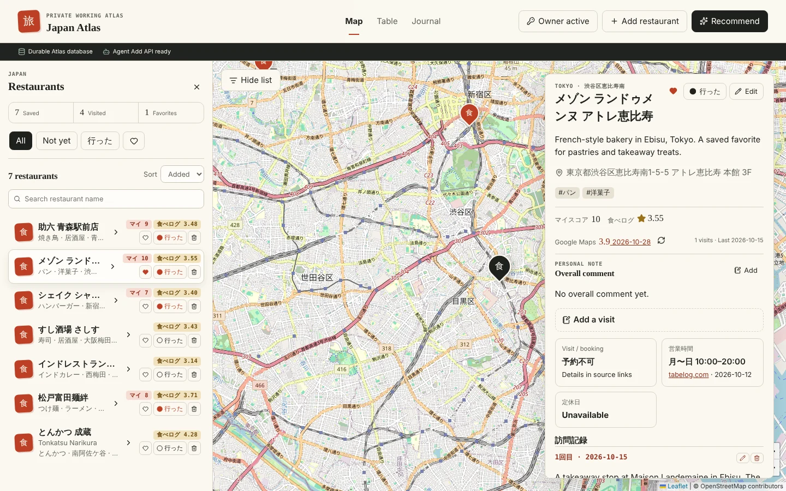
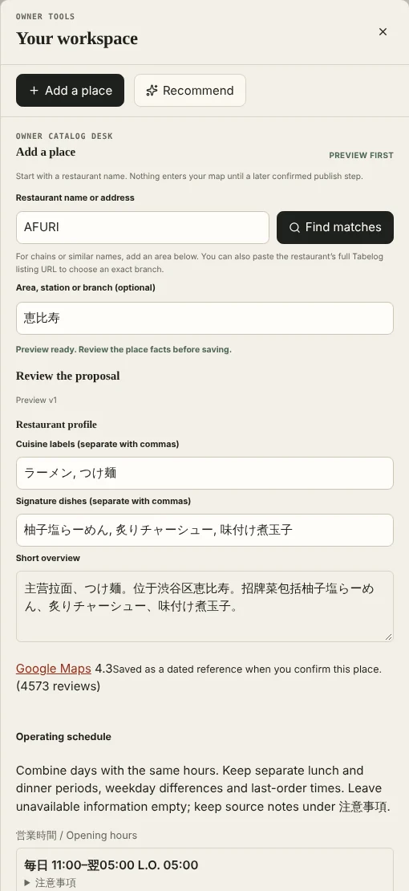
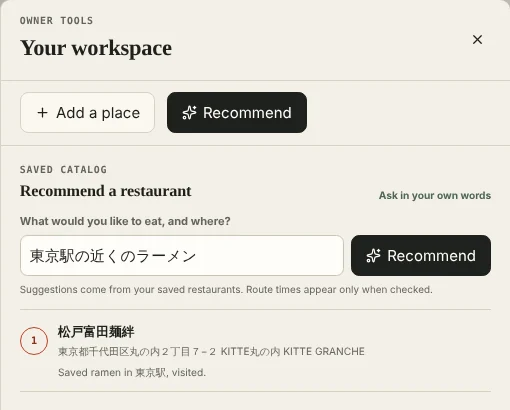
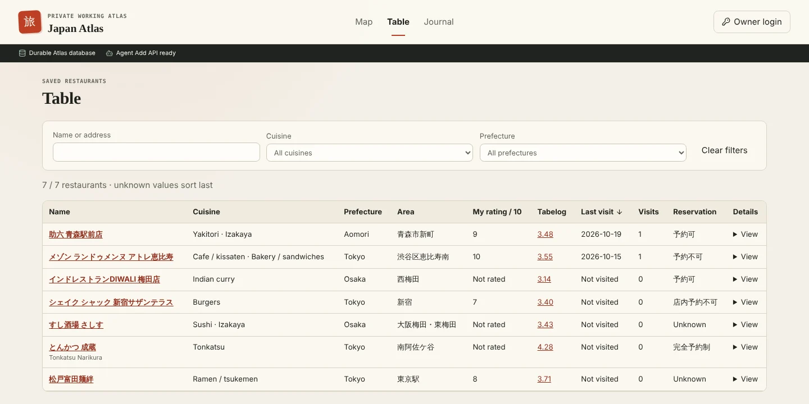
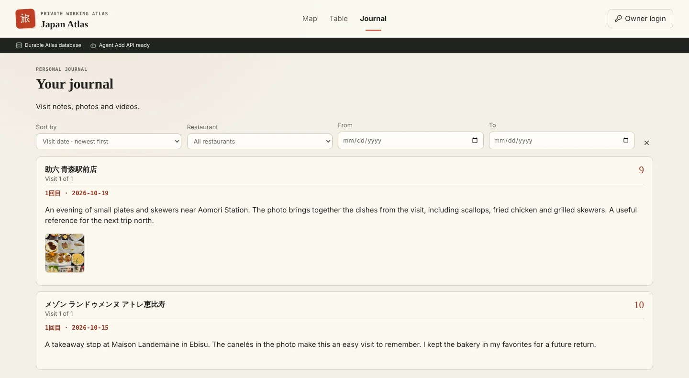
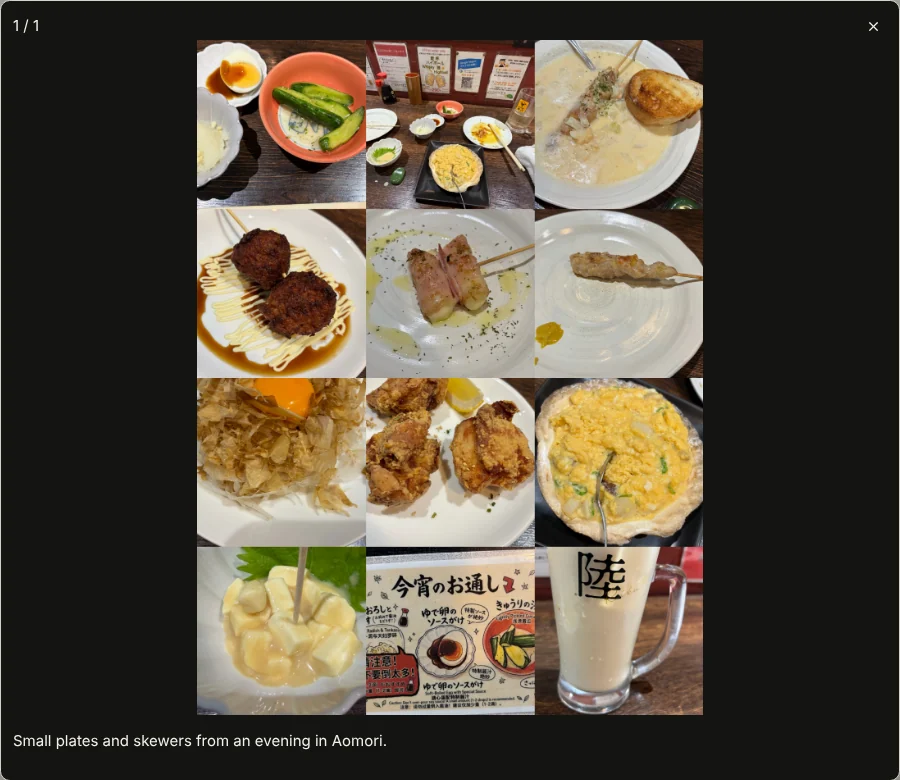

# Place Atlas

**Japan Atlas 0.1.0** — a quiet, self-hosted map and journal of the restaurants you find, in Japan. You run it on your own Cloudflare account, so your records, photos and keys stay with you.

**Live demo: [japan-demo.japan-atlas-poc.workers.dev](https://japan-demo.japan-atlas-poc.workers.dev/)**. Anyone can browse it. Add and Recommend need the demo's Owner password.



## Why

Restaurants turn up everywhere: an Instagram reel, a RED post, a YouTube video, a friend's message. Collecting them by hand into map lists is tedious, and Google Maps lists cannot be filled in by an AI agent. And writing down what you thought usually means a public review that everyone can read, when what you want is a quiet place for your own comments and a record of every visit.

Place Atlas is one place that gathers them for you and keeps them private: you add a restaurant in a few words, keep your own scores, comments and visit journal, and ask your own list for a recommendation.

## Features

| | |
| --- | --- |
| **Add** | Type a name (and area) or paste a Tabelog URL. The place is matched on Google Maps, located, and filled in with its Tabelog score, hours, reservation rule, cuisine and links. Only sourced facts are kept, and you review everything before it is saved. |
| **Recommend** | Ask in your own words, such as *ramen near Tokyo Station I haven't been to*. Answers come only from your saved restaurants, with walking times when the route sidecar is set up. |
| **Map, Table, Journal** | Browse, search, filter and sort your restaurants on a map or in a table, and every visit in a journal. |
| **Your notes** | A 0–10 score, favorite, visited state and comments for each restaurant; notes, scores, photos and videos with captions for each visit. |
| **Owner and visitors** | Anyone with the link can browse; only you, the Owner, can change anything. |

[docs/features.md](docs/features.md) explains how Add checks facts and handles failures, and how Recommend reads a request.

<table>
  <tr>
    <td width="50%" valign="top"></td>
    <td width="50%" valign="top"></td>
  </tr>
</table>





<p align="center"></p>

## Deploy your own

Place Atlas 0.1.0 runs on **Cloudflare** (Workers, D1 and R2); other hosts are not supported yet. A personal deployment fits Cloudflare's free tiers.

### What only you can do

1. **GitHub**: fork or clone this repository.
2. **Cloudflare**: create an account, then in the dashboard open **R2** and enable it (Cloudflare asks for a payment method even for the free tier).
3. **Sign in** on your computer with `npx wrangler login` (it opens your browser). On the first deploy, Wrangler may ask you to choose your `workers.dev` subdomain.
4. **Choose** an Owner password and get your own API keys (see [Keys you provide](#keys-you-provide)). Only you can sign up for these services.

### Keys you provide

Place Atlas has no shared keys: each deployment uses its owner's own accounts.

| Key | Needed for | Where to get it |
| --- | --- | --- |
| **Model key**: DeepSeek (tested) or OpenAI | Required for the Add research agent and Recommend. Without it, Add only finds and locates the place. | DeepSeek: [platform.deepseek.com](https://platform.deepseek.com) → API keys (top up a small balance first). OpenAI: [platform.openai.com](https://platform.openai.com/api-keys). Saved in **Model settings** on your site after deploying, not with Wrangler. |
| **Google Places key** (`GOOGLE_PLACES_API_KEY`) | Recommended. Add checks the name against Google Maps and shows the matching branches; the Owner can load Google ratings. Without it, Add searches Tabelog through web search. | [Google Cloud console](https://console.cloud.google.com): create a project, enable billing, enable **Places API (New)**, then **APIs & Services → Credentials → Create credentials → API key**. Restrict the key to Places API (New). |
| **Google Maps key for the route sidecar** (`GOOGLE_MAPS_API_KEY`) | Optional. Recommend from a station or address, with walking times. | The same Google Cloud project: enable **Geocoding API** and **Routes API** and create a second key restricted to those two. |
| **Firecrawl key** (`FIRECRAWL_API_KEY`) | Recommended. Tabelog often refuses requests coming directly from Cloudflare; Firecrawl reads the pages instead. | [firecrawl.dev](https://www.firecrawl.dev) → API keys (the free plan is enough to start). |
| **Tavily key** (`SEARCH_API_KEY`) | Optional. Web search for the research agent; otherwise public search pages are used. | [tavily.com](https://tavily.com) → API keys. |

Google includes free monthly usage for each of these APIs and bills beyond it; Place Atlas also stops calling Google when its own monthly caps are reached. Keys are stored as Cloudflare secrets or encrypted in your database, never in the repository.

### Deploy step by step

You need Node.js 22.13 or newer.

```sh
git clone https://github.com/<you>/place-atlas.git
cd place-atlas/apps/web
npm ci
cp wrangler.jsonc wrangler.local.jsonc        # your deployment config (ignored by git)

npx wrangler d1 create place-atlas            # prints a database_id
# In wrangler.local.jsonc, replace 00000000-0000-4000-8000-000000000000 with that database_id.

npx wrangler r2 bucket create place-atlas-media
npx wrangler d1 migrations apply DB --remote --config wrangler.local.jsonc
npm run deploy                                # prints your site URL

npx wrangler secret put ATLAS_OWNER_PASSWORD --config wrangler.local.jsonc
openssl rand -hex 32 | npx wrangler secret put ATLAS_OWNER_SESSION_SECRET --config wrangler.local.jsonc
```

Your site now works for browsing. Then:

1. **Google Places** (recommended):

   ```sh
   npx wrangler secret put GOOGLE_PLACES_API_KEY --config wrangler.local.jsonc
   ```

   In `wrangler.local.jsonc`, change `"CATALOG_INTAKE_GOOGLE_PLACES_MODE": "disabled"` to `"enabled"`.

2. **Firecrawl** (recommended):

   ```sh
   npx wrangler secret put FIRECRAWL_API_KEY --config wrangler.local.jsonc
   ```

3. **Route sidecar** (optional): see [Route sidecar](#route-sidecar-optional).
4. Run `npm run deploy` again if you changed `wrangler.local.jsonc`. (Secrets take effect without a deploy.)
5. **Model settings**: open your site, choose **Owner login** with your password, open **Model settings**, paste your key and save. The form is filled in for DeepSeek:

   | Provider | API base URL | Model |
   | --- | --- | --- |
   | DeepSeek (tested) | `https://api.deepseek.com` | `deepseek-flash` |
   | OpenAI | `https://api.openai.com/v1` | an OpenAI model that supports tool calling |

   Saving checks the connection. Other providers are not accepted yet. The model powers the Add research agent and reads Recommend requests. Without it, Add still finds and locates places, and Recommend says it is unavailable.

6. Try it: **Add** a restaurant you know (for example `一蘭 渋谷`), confirm it, then ask **Recommend** for it.

To update later: `git pull`, `npm ci`, apply migrations again (`npx wrangler d1 migrations apply DB --remote --config wrangler.local.jsonc`), then `npm run deploy`.

### Optional settings

Set secrets with `npx wrangler secret put NAME --config wrangler.local.jsonc` and plain values under `vars` in `wrangler.local.jsonc` (then `npm run deploy`).

| Name | Purpose |
| --- | --- |
| `GOOGLE_PLACES_API_KEY` + `CATALOG_INTAKE_GOOGLE_PLACES_MODE=enabled` | Add checks the typed name against Google Maps, and the Owner can load Google ratings. Without it, Add searches Tabelog. Monthly request caps are kept in D1. |
| `FIRECRAWL_API_KEY` | Reads Tabelog through Firecrawl (`RESTAURANT_SOURCE_READER=firecrawl`, the default). Tabelog often refuses requests from Cloudflare directly, so this is recommended. |
| `CATALOG_INTAKE_DURABLE_GEOCODER_MODE=enabled` | Confirms coordinates with OpenStreetMap Nominatim (on by default; cached for 30 days). |
| `SEARCH_API_KEY` | Tavily web search for the research agent (otherwise public search pages are used). |
| `AGENT_API_KEY`, `AGENT_BASE_URL`, `AGENT_MODEL` | A server-managed model instead of the Owner's Model settings form. |
| `AGENT_SETTINGS_SECRET` | A separate 32+ character key for encrypting saved model keys (defaults to the session secret). |
| `ATLAS_ADD_AGENT_TOKEN` | A 32–128 character URL-safe Bearer token for the external Add Agent API. |
| `ATLAS_PUBLIC_URL` | Your site URL, sent to Nominatim as contact information. |
| `ROUTE_SIDECAR` service binding | Recommend from a station or address, with walking times (below). Without it, food and area requests still work. |

#### Route sidecar (optional)

A second, private Worker (no public URL) holds the Google Maps key for geocoding and walking times:

```sh
npm run deploy:route-sidecar
npx wrangler secret put GOOGLE_MAPS_API_KEY --config wrangler.route-sidecar.jsonc
```

Then, in `wrangler.local.jsonc`, uncomment the line `"services": [{ "binding": "ROUTE_SIDECAR", "service": "japan-atlas-route-sidecar" }],` and run `npm run deploy` again.

## Develop

```sh
cd apps/web
npm ci
printf 'ATLAS_OWNER_PASSWORD=dev\nATLAS_OWNER_SESSION_SECRET=%s\n' "$(openssl rand -hex 32)" > .dev.vars
npx wrangler d1 migrations apply DB --local
npm run dev            # Vite and the Worker on http://localhost:5173
npm test               # unit and wiring tests
npm run benchmark      # Add/Recommend benchmark (see benchmarks/README.md)
npm run lint && npm run typecheck && npm run format:check
```

See [features](docs/features.md), [status](docs/status.md) and [architecture](docs/architecture.md) for details.
