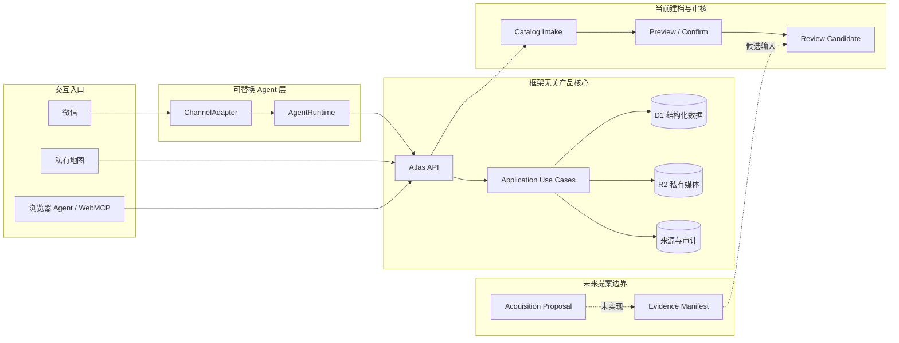

# Japan Atlas 系统架构与开发指南

状态：有效架构基线
最后更新：2026-09-24

## 1. 架构原则

Japan Atlas 是一个产品核心加多个可替换入口：公开只读／Owner 写入地图、浏览器 Agent、微信／OpenClaw 和 CLI 都必须调用同一套应用操作并读取同一份持久数据。

采用两项互补原则：

- **Ports & Adapters**：渠道、Agent runtime、采集器、地图供应商和存储实现都在端口后面替换。
- **Web 边界使用 MVVM**：React View 只负责渲染和收集意图；ViewModel 负责状态、乐观更新、操作编排和失败回滚。

依赖始终指向领域核心。任何渠道、模型或采集器都不能直接访问 D1 表或 R2 对象。

## 2. 逻辑拓扑



## 3. 当前实现与目标边界

### 已实现

- 公开只读、Owner 写入的 Sites Web 应用；
- D1 schema、不可变 migration 和持久 API；
- AtlasItem、CatalogIntakeSession、Review Candidate、PlaceAssessment、Visit 与 VisitMedia；
- R2 私有图片、签名／大小／哈希校验、说明和删除；
- 地图、搜索、筛选、乐观写入和 Journal 纠错；
- WebMCP 浏览器工具与 Web UI 共用 Browser AtlasApplication／HTTP 操作；
- 框架无关的 `AtlasApplication`、静态 operation catalog、领域 handlers 与 D1/R2/InMemory ports；
- 全部现有 HTTP 读写经唯一 server composition 调用同一 Application Operations；
- Browser、capabilities 与 WebMCP 共用同一 HTTP/operation mapping；
- 网页与微信／OpenClaw 共用 Catalog Intake 的 discover、select、confirm、cancel，证据不足的结果只进入 Owner Review；
- 架构适应度测试覆盖依赖方向、无环、handler 隔离、operation key 与旧 store 绕行；
- CI 的格式、Lint、类型、单元测试与生产构建。

### 尚未实现或尚未形成服务边界

- 供 24/7 Agent 使用的 scoped authentication、授权和审计；
- Acquisition & Review 的未来 proposal adapter（当前没有 creator collector、ImportJob route 或后台导入队列）；
- 对话式 Visit capture session；
- 微信／OpenClaw 的 Record／照片适配、重试恢复和七天 soak；
- 生产备份恢复、弱网策略和提醒 worker。

浏览器 WebMCP 已能执行多项读写操作，但它不是面向云端 Bot 的最终安全 API。

## 4. 代码依赖方向

```text
React View
  -> Atlas ViewModel
    -> Browser API Client
      -> Route Handler
        -> AtlasApplication
          -> Domain Operation Group
            -> State / Object Port
              <- D1 / R2 Adapter

WebMCP / 微信 Adapter
  -> 同一 Application Use Case
  -> 不导入 React、D1 或 R2 实现
```

| 层 | 当前职责 | 位置 |
|---|---|---|
| Product Core | 类型化 Application Operations、业务不变量、领域类型与 ports | `apps/web/product/application/**` |
| UI 类型兼容层 | Product Core record 的 type alias 与 Web-only view/filter 类型 | `apps/web/features/atlas/model.ts` |
| 可信初始目录 | 经来源核验的内置记录 | `apps/web/features/atlas/verified-items.ts` |
| View | 地图、列表、详情、Owner Review／Journal | `apps/web/features/atlas/atlas-screen.tsx` |
| ViewModel | 客户端状态、乐观更新、API 编排与回滚 | `apps/web/features/atlas/use-atlas-view-model.ts` |
| Browser Adapter | 类型化 HTTP 调用 | `apps/web/features/atlas/atlas-api-client.ts` |
| 共享 Browser mapping | Browser、capabilities 与 WebMCP 的唯一 HTTP/operation 映射 | `apps/web/features/atlas/atlas-browser-operation-catalog.ts` |
| Browser Agent Adapter | WebMCP 工具注册 | `apps/web/features/atlas/use-atlas-webmcp.ts` |
| Map Port / Adapter | 地图生命周期、marker 对账和供应商隔离 | `apps/web/features/atlas/map-adapter.ts`、`leaflet-map-adapter.ts` |
| Server composition | 唯一静态 operation catalog、系统 Clock/IdSource/hash 注入 | `apps/web/lib/server/application/server-atlas-application.ts` |
| Infrastructure adapters | D1 record state 与 R2 media object ports | `apps/web/lib/server/application/**` |
| Delivery | HTTP routes | `apps/web/app/api/**` |
| Persistence | schema 与 migration | `apps/web/db`、`apps/web/drizzle` |

`atlas-screen.tsx` 仍包含多个过渡 View。可以继续拆分列表、详情、Visit 时间线和图库，但不得复制 ViewModel 或 API 逻辑。

## 5. 领域记录与不变量

| 记录 | 责任与关键不变量 |
|---|---|
| `AtlasItem` | 地点／活动／建筑的唯一身份；日文优先名称、坐标、类型与验证状态 |
| Source assertion | 派生事实的 URL、观察时间、证据位置和采集方法；当前部分仍内嵌于目录记录 |
| 外部评分快照 | 分数、评论数、来源 URL 与核验日期；不是永久事实 |
| Reservation snapshot | 预约方式、放号范围、例外、来源和核验时间；实时库存不作长期事实 |
| `CatalogIntakeSession` | 餐厅发现、候选选择、版本化 Preview、确认／取消的短时状态；过期或冲突不得静默写入 |
| Review Candidate | 证据不足或冲突的 Owner-only 地点；不得进入公开地图或 Nearby |
| `PlaceAssessment` | 每地点一个可空总体评分、喜欢、显式到访状态和长期总结 |
| `Visit` | 可重复的到访日期与可选笔记；不拥有独立评分 |
| `VisitMedia` | Visit 归属、R2 object key、MIME、大小、哈希、顺序和可选说明 |
| Tombstone | 防止已删除的内置目录记录在刷新后重新出现 |

有效到访状态已经统一为 `存在 Visit OR manualVisited`：真实 Visit 不能被人工“没去过”覆盖；删除最后一条 Visit 后，仅当此前独立保存了 `manualVisited=true` 才继续显示 `行った`。D1 adapter 在内部把旧列 `has_visited` 解释为 `manualVisited`，HTTP compatibility adapter 继续接受旧字段名 `hasVisited`；业务核心和新接口不得使用旧语义，`personalState: visited` 也不参与有效到访计算。

`journal_entries` 是旧兼容表，不应承载新功能；新开发只使用 `visits` 与 `place_assessments`，待迁移安全窗口确定后再删除旧表。已部署环境中的 `import_jobs` 也只是遗留物理表：当前没有对应的领域 capability、route 或 UI；只能通过后续安全 migration 清理，不能把表存在解释为 ImportJob 仍受支持。

## 6. 应用操作与写入契约

当前唯一静态 catalog 覆盖：

- 地点：list、get、保存 `needs_review` 采集结果、update、delete；
- 地点建档：discover、select、confirm、cancel；
- 发现：search、nearby；
- 个人状态：rating、favorite、manual visited、summary update；
- Visit：list、create、update、delete；
- 媒体：attach、list/content、caption、delete；

当前不包含 creator／ImportJob 的 list、queue 或 delete 操作。未来 Acquisition Proposal 若获确认，必须先形成新的 operation contract 和证据边界，不能复用遗留物理表绕过 Catalog Intake／Review。

这些 operation 由领域 group 静态组合一次；JSON 与 media-stream key 在类型层分离，不能 runtime registration。HTTP route 只解析协议和映射 `Result`，不得导入数据库、对象存储或重新实现评分、到访、目录合并、搜索、距离与删除规则。

以下是目标写入契约；当前 Visit create 已具备特征化重投与 D1 原子边界，但通用审计、授权和所有 mutation 的幂等仍属于 `APP-02`：

1. 在 delivery 边界做运行时类型和范围校验；
2. 使用稳定 mutation/message ID 实现幂等；
3. 相关写入使用原子 batch，避免半完成状态；
4. 返回人类可读且可审计的 receipt；
5. UI 先乐观更新，失败时由 ViewModel 恢复；
6. 删除和不可逆的外部动作需要明确确认；
7. 渠道 adapter 只传递已授权的窄工具，不提供 shell、任意文件或数据库权限。

### Visit 与媒体

- Web 可以在创建 Visit 时同时选择图片；ViewModel 先持久化明确 Visit ID，再附加二进制。
- 单次 HTTP 请求最多四张、每张最多 8 MB；这是传输预算，不是 Visit 总量限制。
- Web 单次选择最多 24 张，自动拆分请求；完成的批次即时进入状态。
- 当前支持经文件签名验证的 JPEG、PNG、WebP 和 GIF。
- R2 写入失败不创建元数据；元数据 batch 失败时清理已写对象。
- 仍需补齐服务端可信尺寸、缩略图策略、失败批次重试和 D1↔R2 孤儿清理。

未来 `VisitCaptureSession` 位于媒体端口之上，按“已认证用户＋conversation＋明确地点”限定。显式 session、回复引用或明确地点优先；上下文有歧义时必须询问。渠道 message ID 作为幂等键，低层媒体端口不得猜测照片归属。

## 7. 数据、部署与安全边界

- v1 结构化数据以 D1 为基线，私有媒体以 R2 为基线；只有出现明确规模、空间查询或服务限制证据时才重新评估 Postgres/PostGIS。
- Sites 当前使用公开读取投影与 Owner session 写门。云端 Bot 使用独立 scoped credential、签名、授权和审计边界；两种入口不得互换凭证。
- 24/7 产品核心与任何未来的高权限来源 adapter 分离：消息/API/提醒常驻云端；若以后确有登录来源需求，其浏览器只能留在本机隔离 profile。
- 浏览器 Cookie 不上传云端；本地控制端口仅绑定 loopback，完成任务后停止高权限采集会话。
- 浏览器控制即使只绑定 loopback，也可能被同机不可信进程利用并执行任意页面脚本；它必须短时启停，且不能与常驻 Agent 共用权限域或凭证。
- 第三方网页、OCR、评论、文件名和模型输出均视为不可信输入。
- URL 仅允许经过校验的协议；连接器输出必须通过版本化 schema。
- migration 一经部署不可修改；新增变化创建新 migration。
- 私有照片和个人笔记不得用于公开 fixture、日志正文或作品集 demo。

## 8. 性能与可靠性预算

| 项目 | 目标 |
|---|---:|
| 可见乐观更新 | p95 ≤ 100 ms |
| 主线程长任务 | ≤ 200 ms |
| 地图帧间隔 | p95 < 50 ms，最大值 < 100 ms |
| 100 ms fixture tile 条件下地图稳定 | p95 < 400 ms |
| Visit create／edit／delete D1 binding 往返 | 各 2 次 |
| mutation 重试产生重复／半写入 | 0 |

私有 Sites API 当前存在约两秒的鉴权／运行时回包底噪。前台必须依靠乐观更新避免暴露该等待；若后台同步时长影响 Agent 运维，再基于实测评估独立 APAC API。Issue [#2](https://github.com/AndyZhou952/jp-food-event-map/issues/2) 已关闭。

地图仍使用 Leaflet + OSM 栅格基线，并已通过 adapter 隔离。不得批量压测公共 OSM；自动化性能测试使用拦截或 fixture tiles。剩余托管交互性能由 [#1](https://github.com/AndyZhou952/jp-food-event-map/issues/1) 跟踪，未取得证据前不直接更换引擎。

## 9. 本地开发与验证

要求 Node.js 22.13 或更高版本。

```bash
cd apps/web
npm ci
npm run dev
```

提交前运行：

```bash
npm run format:check
npm run lint
npm run typecheck
npm test
npm run build
```

CI 会在 Pull Request 以及 `main` push 上运行同一组检查。

默认测试同时执行架构适应度门：Product Core 禁止框架／供应商／feature import，生产依赖图不得成环，operation handlers 不得横向互调，route 到旧 store 的直连与第二 HTTP operation mapping 必须为零。静态 catalog 从导出的 server factory 实际返回表达式出发，按 TypeScript lexical symbol binding 对称追踪唯一 Application factory、`defineOperationGroup`、catalog／group factory／operation value 的命名导入与只读 const alias chain；namespace、dynamic、mutable／循环 alias、参数／局部遮蔽、游离 group 和伪造 catalog 都失败关闭。Browser、capabilities、WebMCP 只允许从唯一 mapping owner 命名导入各自白名单 symbol；search、rating、model 兼容 adapter 的 import/export 路径、named/type specifier 与声明形状也使用严格白名单，拒绝裸导入、任意 Product 依赖和含顶层副作用的 owner。owner 的 eager-effect 检查会沿本地 runtime import／re-export 递归审计 initializer、IIFE、赋值／更新、调用／构造、await／yield、tagged template 以及 class static／computed 执行路径；纯 type-only 依赖、纯数据和 lazy function／arrow／class 定义不会产生运行时边，依赖循环、无法解析的本地模块和未列入白名单的外部运行时包都失败关闭。`typecheck` 还会执行 operation key/input/output 关联以及 JSON/media key 负面编译测试。

适应度门的公开 violation 与异常输出统一经过同一条“先分类、再格式化”的脱敏出口：`rule` 是封闭枚举，`detail` 只能由固定代码、安全标识符或结构化路径分类产生，不得包含 AST/source 原文、module specifier 或捕获到的异常消息／stack；仓库内文件必须通过 `realpath` 与相对路径验证后才能输出仓库相对路径。POSIX（包括任意数量的前导 `/`）、Windows／混合分隔符、UNC／`file://` 绝对路径（包括 query/hash）以及指向仓库外的目录穿越路径只返回幂等的固定安全标记，不输出真实路径或参数内容。解析或解析依赖时发生的异常只返回固定错误代码。

适应度门通过“模块所有权 + 已知规则 primitive + 严格 adapter 形状”阻止当前可预见的第二实现入口；它不是对任意代码语义等价性的数学证明。新增搜索、评分、到访或 HTTP mapping 语法时，必须先补一个会失败的坏 fixture，再扩展 AST 检查，不能用更宽松的文本正则替代。

已踩坑原则：

- 读写能力必须在类型和构造层真实成立；没有写 state/Clock 时只能组合只读 group，不能公开一个运行时必失败的写 key。
- 业务校验必须在 Application seam 再执行一次，不能只信任 HTTP inbound；例如采集条目的空白身份字段必须由核心拒绝。
- operation key 只在领域 descriptor 定义并由 server composition 静态汇总；Browser/capabilities/WebMCP 的 HTTP 映射只维护一份。
- `apps/web/features/atlas/verified-items.ts` 是必要静态 seed；`features/atlas/model.ts` 只保留 Product Core type alias 与 UI-only 类型，不复制 record 结构。
- `journal_entries`、旧 HTTP 字段名与 `personalState: visited` 仅是数据／协议兼容，不得成为第二套业务实现。

## 10. 开发检查表

新增或修改功能时确认：

- View 是否只表达界面意图，状态编排是否在 ViewModel／use case；
- Web、WebMCP 和未来 Agent 是否调用同一个操作；
- 写入是否幂等、原子、可回滚、可审计；
- 外部事实是否包含来源和核验时间；
- 是否避免全表读取、marker 全量重建和整张地图 filter／blur；
- 删除是否处理关联 D1 元数据、R2 对象与 tombstone；
- 测试是否覆盖成功、重复、失败回滚和权限边界；
- 细节任务与验收证据是否写入 Issue，而不是继续膨胀核心文档。
