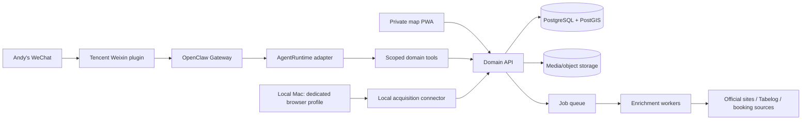

# System Architecture and Agent Harness Selection

Status: proposed
Last updated: 2026-09-05
Decision owner: Andy Zhou

## 1. Recommendation

For v1, use **OpenClaw as the WeChat channel gateway and initial orchestration
shell**, not as the database or permanent product core.

The product core should be a small domain API and worker system that exposes
narrow tools such as `capture_source`, `find_nearby`, `confirm_place`,
`add_visit`, and `schedule_reminder`. The map app and every possible agent
runtime use those same tools.

This gives the shortest path to WeChat without making a permanent bet on one
agent framework. If OpenClaw proves unreliable, the runtime can later move to
the OpenAI Agents SDK, Claude Agent SDK, Hermes, or a custom Pi-based loop while
the map, data, evaluation fixtures, and source connectors remain intact.

## 2. What each candidate actually is

The candidates are not direct substitutes in every dimension.

| Candidate | Best role here | Strength | Main gap for this project |
|---|---|---|---|
| OpenClaw | 24/7 channel gateway and first runtime | Existing WeChat plugin, media messages, skills/plugins, cron, many model providers | Broad host permissions unless explicitly restricted; external WeChat plugin is an operational dependency |
| Hermes Agent | Challenger personal-agent runtime | Cross-session memory, self-improving skills, cron, portable models, VPS-oriented | No documented WeChat channel; custom bridge required |
| OpenAI Agents SDK | Production orchestration if we own the loop | Typed tools, sessions, guardrails, tracing, approvals, resumability | No WeChat gateway; provider-oriented; more application code |
| Claude Agent SDK | Production orchestration alternative | Tools, hooks, MCP, permissions, sessions, observability | No WeChat gateway; third-party products require API credentials rather than a consumer Claude login |
| Pi | Embedded/custom minimal runtime | Small, extensible core and extensions | Coding-agent orientation; no ready 24/7 WeChat operations layer |
| Codex / Claude Code | Development harness | Excellent for building, testing, migrations, and repository work | They are not the durable database or messaging gateway |
| Codex SDK | Programmatic coding worker | Can run Codex agents from server code | Coding-agent semantics are a poor default for daily food/map conversations |

Codex can participate in deployment, but mostly as the engineer that builds and
maintains the deployed application. A server process can invoke the Codex SDK,
yet that does not make Codex the best chat runtime for this product.

## 3. Proposed topology



### Cloud, always on

- OpenClaw Gateway and WeChat session;
- domain API and queue;
- small workers for text extraction, search, reminders, and source freshness;
- private PWA;
- managed PostgreSQL/PostGIS and object storage, or a self-hosted pilot database;
- monitoring, backups, and encrypted secrets.

### Local, on demand

- dedicated Chrome profile logged into Xiaohongshu/Bilibili when needed;
- `web-access`, Playwright/CDP, or another source connector behind one interface;
- user-triggered batch discovery and upload of evidence manifests;
- optional local video preprocessing if raw media should not leave the laptop.

The local worker can be offline without breaking the map, WeChat capture,
nearby recommendations, or reviews. It only delays bulk enrichment.

## 4. How the components connect

### Normal link capture

1. Andy sends a link, screenshot, photo, voice note, or text to the bot.
2. The WeChat plugin turns the message into a normalized channel event.
3. The runtime calls `capture_source` with message attachments and provenance.
4. The API immediately writes an inbox record and returns a receipt. Capture
   does not wait for slow analysis.
5. A worker extracts candidate places/events and attaches evidence.
6. High-confidence items are confirmed; ambiguous items appear as a short
   review card with up to three candidates.

### Nearby recommendation

1. Andy shares location or types an area/station.
2. The runtime calls `find_nearby`; PostGIS performs distance and deterministic
   feasibility filters.
3. The model ranks only the resulting shortlist and explains three choices.
4. The response links to the PWA map and flags stale hours or booking facts.

### Review capture

1. Andy sends photos and a sentence/voice note after a visit.
2. The runtime resolves the active or nearby place and asks at most one
   disambiguation question.
3. `add_visit` stores the review, score, spend, photos, and original message.
4. The personal preference profile is derived later; it is never the sole copy
   of the review.

## 5. Stable contracts for decoupling

The implementation should define these interfaces before adding platform code:

```text
ChannelAdapter       inbound messages, outbound cards, identity allowlist
AgentRuntime         message -> tool calls -> response, session lifecycle
SourceConnector      discover/fetch a source and return an evidence manifest
PlaceResolver        evidence -> ranked canonical-place candidates
ReservationProvider place -> sourced booking facts
MapProvider          geocoding, tiles, directions links
MediaStore           original/derived media lifecycle
NotificationSink     reminder delivery with idempotency
```

Suggested repository layout:

```text
apps/
  web/               map PWA and review UI
  api/               durable domain service
  worker/            extraction, resolution, freshness, reminders
  eval-runner/        reproducible offline and staging evaluations
packages/
  domain/             entities and business rules, no framework imports
  contracts/          schemas and interfaces
  connectors/         Xiaohongshu/Bilibili/YouTube/Tabelog/etc. adapters
  agent-runtime/      OpenClaw adapter plus later challengers
  prompts/            versioned extraction/ranking prompts
  ui/                 shared interface components
config/
  examples/           publishable example preferences and source definitions
infra/                containers, deployment, backups, observability
docs/                 product, ADRs, runbooks, evaluations
evals/
  fixtures/           licensed/user-provided test inputs or source references
  expected/           human-reviewed gold labels
  runs/               ignored generated reports
```

Personal sources, account IDs, trip dates, private notes, and secrets belong in
private configuration/database records, not in reusable domain packages.

### Frontend separation (MVVM-inspired)

MVVM is useful at the UI boundary, but it is not the architecture for the whole
system. Apply it pragmatically:

- **Model:** generated API contracts and immutable domain-shaped data;
- **ViewModel:** screen-specific hooks/services that load data, coordinate
  commands, expose view state, and contain no JSX;
- **View:** accessible components that render state and emit user intent;
- **Domain/application:** remains outside the frontend and uses Ports & Adapters.

Views must not call Supabase, OpenClaw, or source connectors directly. ViewModels
depend on an API client interface, making them testable without a browser. Avoid
a single global store; keep server state, URL/filter state, and short-lived UI
state separate.

### Backend engineering practices

- dependency direction points inward: adapters depend on application/domain;
- domain entities do not import framework, database, model, or transport code;
- commands and queries have explicit schemas and idempotency rules;
- transaction boundaries live in application services;
- external providers are accessed through ports with contract tests;
- migrations are append-only after shared environments exist;
- structured logs and traces carry correlation/message IDs;
- errors are typed into retryable, user-correctable, and permanent categories;
- configuration is validated at startup and secrets never receive defaults;
- unit tests cover pure rules; integration tests cover database/provider
  boundaries; end-to-end tests cover only critical user journeys.

## 6. Harness evaluation rubric

Restaurant recognition is excluded from this comparison. Run each candidate
with the same model where possible, the same prompts, and the same mocked domain
tools.

| Dimension | Weight | Test |
|---|---:|---|
| WeChat/channel fit | 25% | Text, image, voice, location, long message, reconnection |
| Tool reliability | 20% | Retries, duplicate messages, timeouts, invalid tool output |
| Security/permissions | 15% | Sender allowlist, least privilege, secret isolation, prompt injection |
| Recovery/operations | 15% | Restart mid-task, persisted session, health check, logs |
| Extensibility | 10% | Add one tool and one source connector without core edits |
| Observability/evaluation | 10% | Trace every tool call and replay a test scenario |
| Cost/maintenance | 5% | Idle footprint, upgrade effort, provider portability |

Initial paper assessment favors OpenClaw because channel fit dominates v1.
Hermes is the first challenger if its memory behavior is valuable enough to
justify a custom WeChat adapter. The two SDKs become more attractive if we later
want tighter code-owned control and are willing to build the channel service.

## 7. Security boundaries

OpenClaw's broad execution capabilities are unnecessary for a travel assistant.
The production WeChat agent must not receive an unrestricted shell, filesystem,
or browser tool.

- allowlist only Andy's WeChat identity;
- expose only scoped, validated domain tools;
- separate read and write operations;
- require explicit confirmation immediately before reservations, payments,
  cancellations, or external messages;
- make writes idempotent using the source message ID;
- run the gateway and workers as non-root containers/users;
- keep the database off the public network;
- store secrets outside Git and rotate independently;
- treat webpages, comments, OCR, and transcripts as untrusted evidence, never
  as agent instructions;
- retain an audit trail for every state-changing tool call;
- pin OpenClaw and external plugin versions and test upgrades in staging.

## 8. Deployment sizing and location

For a one-user system that calls remote AI models and does not run a browser or
local model on the server, start with:

- 2 shared vCPU;
- 4 GB RAM;
- 40–80 GB SSD;
- Ubuntu LTS;
- remote object storage for growing photo/video assets;
- managed database if budget permits, otherwise automated encrypted backups.

One vCPU/2 GB may run a pilot but leaves little headroom for OpenClaw, the API,
queue, and upgrades. Video frame extraction or transcription should run as
bounded jobs, preferably locally or on temporary compute, rather than dictate a
larger 24/7 server.

Current published reference prices as of 2026-09-05:

| Provider/region | Rough matching plan | Published monthly price | Comment |
|---|---|---:|---|
| Hetzner EU | CX23, 2 vCPU/4 GB/40 GB | EUR 6.53 incl. German VAT, excluding IPv4 | Cheapest candidate; 2026 pricing changed and low-cost capacity can be limited |
| AWS Lightsail | 2 vCPU/4 GB/80 GB, IPv4 | USD 24 | Predictable and available in Asian AWS regions |
| DigitalOcean | 2 vCPU/4 GB/80 GB | USD 24 | Simpler operations; Singapore region is available |

Europe is technically sufficient for low-volume text traffic. It increases
latency to Japan/Taiwan and may give the WeChat session an unusual source IP.
The decision should therefore be empirical: run the same one-week pilot on the
Mac, then measure an EU VPS against a Singapore/Japan option. Prefer reliability
and stable WeChat reconnection over saving roughly USD 15–20 per month during
the trip.

Official pricing references:

- https://docs.hetzner.com/general/infrastructure-and-availability/price-adjustment/
- https://docs.aws.amazon.com/lightsail/latest/userguide/amazon-lightsail-bundles.html
- https://www.digitalocean.com/pricing/droplets

## 9. Production-runtime decision gate

Keep OpenClaw if a seven-day soak test achieves all of the following:

- at least 99% successful ingress/acknowledgement for test messages;
- automatic reconnection after gateway restart;
- no duplicate domain writes under message replay;
- all media/location types needed for v1 survive normalization;
- every tool call is attributable to a sender and source message;
- resource use stays below 70% of the selected server;
- upgrade and rollback can be performed from the runbook.

If it fails, preserve the WeChat plugin/gateway as a channel bridge and move the
agent loop behind `AgentRuntime`, or build the channel adapter directly around
the selected production SDK.

## 10. Primary references

- OpenClaw overview, skills, plugins, and WeChat channel: https://docs.openclaw.ai/
- Hermes Agent: https://github.com/nousresearch/hermes-agent
- Pi: https://github.com/earendil-works/pi
- OpenAI Agents SDK: https://developers.openai.com/api/docs/guides/agents
- Codex SDK: https://learn.chatgpt.com/docs/codex-sdk
- Claude Agent SDK: https://code.claude.com/docs/en/agent-sdk/overview
