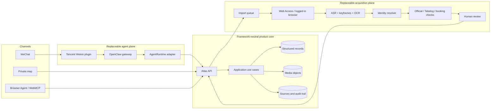
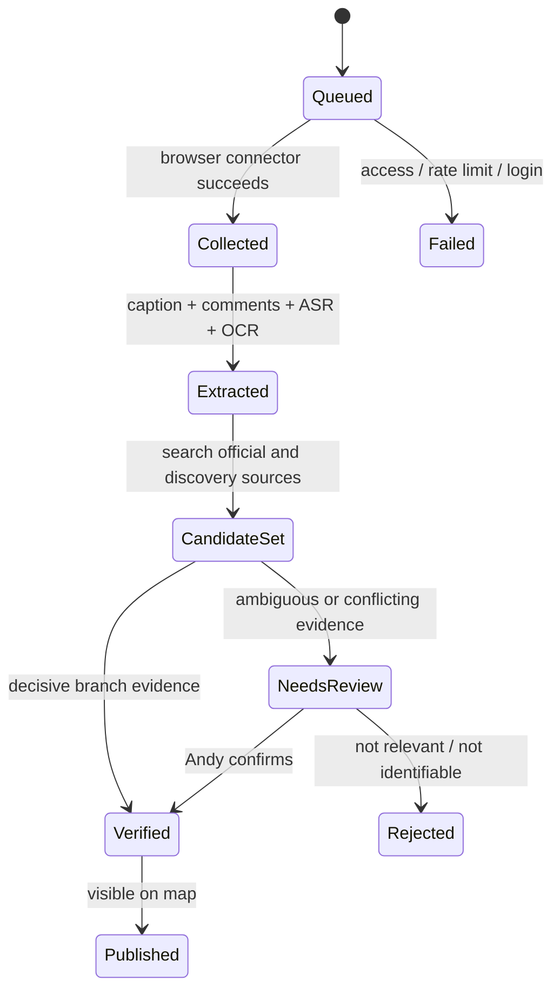

# Japan Atlas Architecture v0.3

Status: active design
Last updated: 2026-09-06
Decision owner: Andy Zhou

## 1. Architectural intent

Japan Atlas is one product with several interchangeable entrances. The map,
WeChat, WebMCP, and a future CLI must call the same application operations and
read the same durable records. The agent is a client of the product core, not
the owner of its memory.

The design uses two complementary patterns:

- **Ports and Adapters** for the whole system, so agent runtimes, social
  collectors, map providers, and storage can be replaced independently.
- **MVVM at the web boundary**, so React components render state while the view
  model owns search, selection, geolocation, edits, import jobs, and journal
  actions.

## 2. Logical topology



## 3. Current implementation boundary

The private web app now provides a real but transitional vertical slice:

- source-checked bootstrap records;
- API endpoints for listing and editing items;
- persistent import jobs, place assessments, and repeatable visits;
- browser geolocation and distance sorting;
- an interactive multi-marker map, collapsible list, structured personal
  filters, and deterministic partial/tag search;
- a WebMCP tool surface for editing, preferences, rating, visits, deletion,
  queueing imports, and nearby lookup using the same view-model actions;
- D1 schema and migrations for durable structured state.

The following are intentionally not represented as complete:

- Web Access can create or consume no job until the local collector worker is
  connected;
- OpenClaw and the Tencent Weixin plugin are not deployed;
- image/video upload and extracted media require object storage;
- the browser WebMCP read contract has been validated against the deployed
  product; the v2 write contract remains to be implemented;
- Sites owner-only access is suitable for the private web UI, but a 24/7
  OpenClaw service may require a separate authenticated API edge.

## 4. Code dependency direction

```text
React views
  -> Atlas view model
    -> browser API client
      -> route handlers
        -> Atlas store port / D1 adapter
          -> D1

Verified catalog
  -> server repository merge
  -> never depends on React, OpenClaw, or Web Access

WebMCP adapter
  -> calls view-model actions
  -> never writes browser-only shadow state
```

Current implementation locations:

| Layer | Responsibility | Location |
|---|---|---|
| Domain contracts | Place, reservation, event, import, assessment, and visit types | `apps/web/features/atlas/model.ts` |
| Verified bootstrap data | Real source-checked records only | `apps/web/features/atlas/verified-items.ts` |
| View | Map, transitional Inbox/Journal, detail and edit forms | `apps/web/features/atlas/atlas-screen.tsx` |
| Map adapter | Leaflet markers, selection, pan/zoom, bounds | `apps/web/features/atlas/atlas-map.tsx` |
| Search policy | Normalization and deterministic fuzzy/tag matching | `apps/web/features/atlas/search.ts` |
| ViewModel | UI state and use-case orchestration | `apps/web/features/atlas/use-atlas-view-model.ts` |
| Browser adapter | HTTP calls | `apps/web/features/atlas/atlas-api-client.ts` |
| Agent adapter | Browser WebMCP tool registration | `apps/web/features/atlas/use-atlas-webmcp.ts` |
| Server adapter | D1 reads/writes and catalog merge | `apps/web/lib/server/atlas-store.ts` |
| Delivery | Item, Inbox, Journal HTTP routes | `apps/web/app/api/**` |
| Persistence | Schema and immutable migrations | `apps/web/db`, `apps/web/drizzle` |

`atlas-screen.tsx` currently contains several transitional view components.
After one layout branch is selected, split the selected-place card, collection
drawer, filters, and visit timeline into focused view modules. This is a
maintainability refactor, not a reason to duplicate view-model or API logic per
layout branch.

The next refactor should move server store interfaces into an application
package before adding OpenClaw. That prevents the WeChat adapter from importing
React or D1 directly.

## 5. Product records

### AtlasItem

Canonical place/event/building identity plus Japanese-first display title,
coordinates, address, classification, personal state, and verification state.

### Source assertion

Every externally derived claim must retain its URL, role, observed time, and
eventual extraction evidence. Current bootstrap records keep the links inline;
the acquisition milestone normalizes them into assertions.

### TabelogSnapshot

Stores the observed score, review count, URL, and checked date. Scores are
snapshots, never timeless facts. The UI must show the source and checked date.

### ReservationSnapshot

Separates:

- whether reservation is possible or required;
- booking channel and link;
- how far ahead inventory is normally released;
- release notes and exceptions;
- last checked time.

Live availability is not cached as a permanent fact. When Andy asks to book or
when a release reminder becomes due, the agent must re-check the booking page.

### ImportJob

A durable request to process a creator profile, channel, post, or platform ID.
States are `queued`, `collecting`, `needs_review`, `completed`, and `failed`.
The job stores counts and diagnostic status, never social account cookies.

### PlaceAssessment

One optional, persistent personal rating and long-term summary per Atlas item.
An absent rating is `NULL`, not zero. Collection/planning state is independent
from whether a visit exists.

### Visit

An appendable visit date and optional note. Visit number, count, last visit, and
visited/unvisited state are derived per item. A visit never duplicates an Atlas
item or owns the place's overall rating.

### MediaAsset / VisitMedia

Photo bytes live in object storage while D1 retains metadata, content hash,
caption, display order, and visit/item relations. Both web and Agent uploads use
the same finalize-and-attach operation.

The implemented media boundary exposes list, multipart attach, private content,
caption update, and delete operations under `/api/media`. The React View never
calls storage directly: it delegates to the Atlas ViewModel, which uses the same
HTTP client intended for an authenticated Agent adapter. Supported files are
signature-checked JPEG, PNG, WebP, and GIF images; one request accepts up to four
8 MB files. R2 failures do not create metadata, and failed metadata batches
remove already-written objects.

The four-file server limit is a bounded request contract, not a Visit limit.
The web client accepts 24 files per selection and sequences bounded requests;
completed chunks enter the ViewModel immediately. The Journal form may select
photos before saving, while the ViewModel still persists an explicit Visit ID
before attaching bytes. Galleries render four thumbnails first and expand on
demand.

Future chat adapters add a short-lived `VisitCaptureSession` above these same
use cases. A session is scoped to authenticated user + conversation + explicit
place, and maps independent channel messages to one Visit. Explicit session,
reply, or place context wins; one recent unambiguous session may be reused;
otherwise the Agent must ask. Channel message IDs provide idempotency. Captions
may arrive with a photo or as a reply to a stable media ID. The low-level media
port never guesses the destination place.

## 6.1 Interface ownership

WeChat is the primary command and capture interface. The private map is the
primary read, spatial organization, and memory interface. The map shows a
selected place's consolidated assessment, visit timeline, and media; ambiguous
acquisition evidence opens through a contextual deep link rather than requiring
a permanent Inbox destination.

The existing Inbox and Journal routes are retained only as transitional
fallbacks until the WeChat adapter has equivalent write operations. Removing
them sooner would leave the product without a usable write path.

## 6.2 Interaction adapters and mutation path

The map View depends on an `AtlasMapAdapter`, not directly on Leaflet. The
Leaflet adapter owns the map instance, injected tile-provider configuration,
keyed marker reconciliation, selection, resize, and destruction. A provider or
engine experiment must keep this boundary and must not change the ViewModel or
Agent contract.

Journal create follows one command path: View -> ViewModel optimistic mutation
-> HTTP client -> route validation -> targeted item resolver -> atomic D1
batch. The client mutation UUID becomes the Visit primary key, so the same
command can be retried without duplication. Visit update/delete reuse the same
ViewModel and HTTP route from both the web UI and browser-Agent tools.

## 6. Acquisition and identity pipeline



Evidence priority for restaurant identity:

1. exact Japanese name, address, phone, booking page, or branch-specific URL;
2. readable signage/menu/storefront OCR;
3. creator caption or comment disclosure;
4. menu/address/landmark combination matched against search candidates;
5. visual similarity alone, which can suggest but cannot auto-confirm.

The 90% target means precision among auto-confirmed exact branches. The system
may abstain. Ambiguous records must go to Inbox review and must not silently
enter the trusted map.

## 7. Agent contract

Application operations remain narrow and auditable:

| Operation | Reads/writes | Confirmation |
|---|---|---|
| `list_atlas_items` / `find_nearby` | Read | None |
| `get_item_details` | Read | None |
| `queue_creator_import` | Write job | Show receipt |
| `update_atlas_item` | Write personal fields | User-approved input only |
| `create_visit` | Write visit with optional note | Show visit receipt |
| `update_visit` | Correct visit date/note and optional persistent score | Save receipt |
| `delete_visit` | Delete one visit and reconcile visited state | Explicit confirmation |
| `set_personal_rating` | Upsert one nullable place rating | Show old/new value |
| `attach_visit_media` | Store/attach photo and caption | Show attachment receipt |
| `search_atlas` / `recommend_places` | Read and rank | Expose applied filters |
| `propose_identity` | Write review candidate | Never publish automatically below threshold |
| `confirm_identity` | Promote to verified | Explicit human confirmation when ambiguous |

OpenClaw, Hermes, Pi, or another runtime implements `AgentRuntime` and maps chat
messages to these operations. No runtime may write tables directly.

## 8. Security and deployment split

- The map is private and currently uses the Sites owner-only access boundary.
- Structured web state lives in D1; photos/video use R2 or equivalent while D1
  retains captions and relations.
- Social logins remain in a dedicated local browser profile. Cookies are never
  uploaded to the cloud database or agent prompt.
- The collector runs on demand and is rate-limited. A secondary social account
  is preferred because automated browsing can trigger restrictions.
- The 24/7 message gateway can run on a small cloud instance only after the
  WeChat proof of concept passes. A VPS is not needed for the present web slice.
- External agent calls need a scoped API credential, request signing, idempotency
  keys, audit events, and per-tool authorization before deployment.

## 9. Harness selection

Keep OpenClaw as the first WeChat candidate because Tencent maintains the
`openclaw-weixin` plugin and it supports messages/media. Pin compatible versions
and test the main-account private-chat flow before choosing infrastructure.

Compare runtimes on channel reliability, tool execution, recovery, security,
maintenance effort, latency, and cost. Restaurant recognition quality belongs
to the acquisition/evidence pipeline and should not be used to select the
harness.

## 10. Current architectural risks

| Risk | Mitigation |
|---|---|
| Social platform layout/login changes | Replaceable collectors, browser profile isolation, manual share fallback |
| Wrong restaurant branch | Evidence ledger, branch keys, abstention, review queue |
| Stale scores/hours/reservation rules | Checked timestamps, per-field freshness, live re-check before action |
| Agent hallucinated write | Typed APIs, validation, review status, audit events |
| Sites private auth unsuitable for cloud bot | Separate signed service API or private tunnel after PoC |
| Framework lock-in | Agent and collectors call product use cases through adapters |
