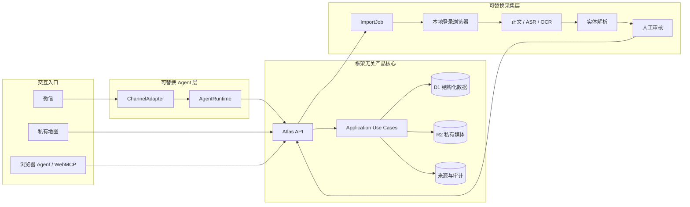

# Japan Atlas 系统架构与开发指南

状态：有效架构基线
最后更新：2026-09-09

## 1. 架构原则

Japan Atlas 是一个产品核心加多个可替换入口：私有地图、浏览器 Agent、未来微信和 CLI 都必须调用同一套应用操作并读取同一份持久数据。

采用两项互补原则：

- **Ports & Adapters**：渠道、Agent runtime、采集器、地图供应商和存储实现都在端口后面替换。
- **Web 边界使用 MVVM**：React View 只负责渲染和收集意图；ViewModel 负责状态、乐观更新、操作编排和失败回滚。

依赖始终指向领域核心。任何渠道、模型或采集器都不能直接访问 D1 表或 R2 对象。

## 2. 逻辑拓扑



## 3. 当前实现与目标边界

### 已实现

- 私有 Sites Web 应用；
- D1 schema、不可变 migration 和持久 API；
- AtlasItem、ImportJob、PlaceAssessment、Visit 与 VisitMedia；
- R2 私有图片、签名／大小／哈希校验、说明和删除；
- 地图、搜索、筛选、乐观写入和 Journal 纠错；
- WebMCP 浏览器工具与 Web UI 共用 ViewModel／HTTP 操作；
- CI 的格式、Lint、类型、单元测试与生产构建。

### 尚未实现或尚未形成服务边界

- 独立的 application ports/use cases 包；
- 供 24/7 Agent 使用的 scoped authentication、授权和审计；
- 能消费 ImportJob 的本地 collector worker；
- 对话式 Visit capture session；
- 微信/OpenClaw 适配器、重试恢复和七天 soak；
- 生产备份恢复、弱网策略和提醒 worker。

浏览器 WebMCP 已能执行多项读写操作，但它不是面向云端 Bot 的最终安全 API。

## 4. 代码依赖方向

```text
React View
  -> Atlas ViewModel
    -> Browser API Client
      -> Route Handler
        -> Application Port / Use Case（下一阶段抽取）
          -> D1 / R2 Adapter

WebMCP / 未来微信 Adapter
  -> 同一 Application Use Case
  -> 不导入 React、D1 或 R2 实现
```

| 层 | 当前职责 | 位置 |
|---|---|---|
| 领域类型 | 地点、来源、预约、评价、Visit、媒体与导入类型 | `apps/web/features/atlas/model.ts` |
| 可信初始目录 | 经来源核验的内置记录 | `apps/web/features/atlas/verified-items.ts` |
| View | 地图、列表、详情、备用 Inbox／Journal | `apps/web/features/atlas/atlas-screen.tsx` |
| ViewModel | 客户端状态、乐观更新、API 编排与回滚 | `apps/web/features/atlas/use-atlas-view-model.ts` |
| Browser Adapter | 类型化 HTTP 调用 | `apps/web/features/atlas/atlas-api-client.ts` |
| Browser Agent Adapter | WebMCP 工具注册 | `apps/web/features/atlas/use-atlas-webmcp.ts` |
| Map Port / Adapter | 地图生命周期、marker 对账和供应商隔离 | `apps/web/features/atlas/map-adapter.ts`、`leaflet-map-adapter.ts` |
| Server Adapter | D1 查询、目录合并和写入 | `apps/web/lib/server/atlas-store.ts` |
| Media Adapter | R2 对象与 D1 媒体元数据 | `apps/web/lib/server/media-store.ts` |
| Delivery | HTTP routes | `apps/web/app/api/**` |
| Persistence | schema 与 migration | `apps/web/db`、`apps/web/drizzle` |

`atlas-screen.tsx` 仍包含多个过渡 View。可以继续拆分列表、详情、Visit 时间线和图库，但不得复制 ViewModel 或 API 逻辑。

## 5. 领域记录与不变量

| 记录 | 责任与关键不变量 |
|---|---|
| `AtlasItem` | 地点／活动／建筑的唯一身份；日文优先名称、坐标、类型与验证状态 |
| Source assertion | 派生事实的 URL、观察时间、证据位置和采集方法；当前部分仍内嵌于目录记录 |
| 外部评分快照 | 分数、评论数、来源 URL 与核验日期；不是永久事实 |
| Reservation snapshot | 预约方式、放号范围、例外、来源和核验时间；实时库存不作长期事实 |
| `ImportJob` | 可恢复的采集请求和状态；不保存社交账号 Cookie |
| `PlaceAssessment` | 每地点一个可空总体评分、喜欢、显式到访状态和长期总结 |
| `Visit` | 可重复的到访日期与可选笔记；不拥有独立评分 |
| `VisitMedia` | Visit 归属、R2 object key、MIME、大小、哈希、顺序和可选说明 |
| Tombstone | 防止已删除的内置目录记录在刷新后重新出现 |

当前有效到访状态为：存在 Visit 一定为 `true`；没有 Visit 时可使用显式标记。删除最后一条 Visit 会进行状态对账。是否要在未来保存“三态人工 override”列在决策登记册中。

`journal_entries` 是旧兼容表，不应承载新功能；新开发只使用 `visits` 与 `place_assessments`，待迁移安全窗口确定后再删除旧表。

## 6. 应用操作与写入契约

核心操作至少覆盖：

- 地点：list、details、update、delete；
- 发现：search、nearby、recommend；
- 个人状态：favorite、visited、personal rating；
- Visit：create、update、delete、history；
- 媒体：attach、list/content、caption、delete；
- 采集：queue import、status、propose/confirm identity。

以下是目标写入契约；当前 Visit create 已具备部分幂等与原子保证，但通用审计、授权和所有 mutation 的幂等仍属于 `APP-01/APP-02`：

1. 在 delivery 边界做运行时类型和范围校验；
2. 使用稳定 mutation/message ID 实现幂等；
3. 相关写入使用原子 batch，避免半完成状态；
4. 返回人类可读且可审计的 receipt；
5. UI 先乐观更新，失败时由 ViewModel 恢复；
6. 删除和不可逆的外部动作需要明确确认；
7. 渠道 adapter 只传递已授权的窄工具，不提供 shell、任意文件或数据库权限。

### Visit 与媒体

- Web 可以在创建 Visit 时同时选择图片；ViewModel 先持久化明确 Visit ID，再附加二进制。
- 单次 HTTP 请求最多四张、每张最多 8 MB；这是传输预算，不是 Visit 总量限制。
- Web 单次选择最多 24 张，自动拆分请求；完成的批次即时进入状态。
- 当前支持经文件签名验证的 JPEG、PNG、WebP 和 GIF。
- R2 写入失败不创建元数据；元数据 batch 失败时清理已写对象。
- 仍需补齐服务端可信尺寸、缩略图策略、失败批次重试和 D1↔R2 孤儿清理。

未来 `VisitCaptureSession` 位于媒体端口之上，按“已认证用户＋conversation＋明确地点”限定。显式 session、回复引用或明确地点优先；上下文有歧义时必须询问。渠道 message ID 作为幂等键，低层媒体端口不得猜测照片归属。

## 7. 数据、部署与安全边界

- v1 结构化数据以 D1 为基线，私有媒体以 R2 为基线；只有出现明确规模、空间查询或服务限制证据时才重新评估 Postgres/PostGIS。
- Sites owner-only 边界只适合当前私有网页。云端 Bot 需要独立 scoped credential、签名、授权和审计边界。
- 24/7 产品核心与按需本地采集分离：消息/API/提醒常驻云端，登录社交平台的浏览器留在本机隔离 profile。
- 浏览器 Cookie 不上传云端；本地控制端口仅绑定 loopback，完成任务后停止高权限采集会话。
- 浏览器控制即使只绑定 loopback，也可能被同机不可信进程利用并执行任意页面脚本；它必须短时启停，且不能与常驻 Agent 共用权限域或凭证。
- 第三方网页、OCR、评论、文件名和模型输出均视为不可信输入。
- URL 仅允许经过校验的协议；连接器输出必须通过版本化 schema。
- migration 一经部署不可修改；新增变化创建新 migration。
- 私有照片和个人笔记不得用于公开 fixture、日志正文或作品集 demo。

## 8. 性能与可靠性预算

| 项目 | 目标 |
|---|---:|
| 可见乐观更新 | p95 ≤ 100 ms |
| 主线程长任务 | ≤ 200 ms |
| 地图帧间隔 | p95 < 50 ms，最大值 < 100 ms |
| 100 ms fixture tile 条件下地图稳定 | p95 < 400 ms |
| Visit create／edit／delete D1 binding 往返 | 各 2 次 |
| mutation 重试产生重复／半写入 | 0 |

私有 Sites API 当前存在约两秒的鉴权／运行时回包底噪。前台必须依靠乐观更新避免暴露该等待；若后台同步时长影响 Agent 运维，再基于实测评估独立 APAC API。Issue [#2](https://github.com/AndyZhou952/jp-food-event-map/issues/2) 已关闭。

地图仍使用 Leaflet + OSM 栅格基线，并已通过 adapter 隔离。不得批量压测公共 OSM；自动化性能测试使用拦截或 fixture tiles。剩余托管交互性能由 [#1](https://github.com/AndyZhou952/jp-food-event-map/issues/1) 跟踪，未取得证据前不直接更换引擎。

## 9. 本地开发与验证

要求 Node.js 22.13 或更高版本。

```bash
cd apps/web
npm ci
npm run dev
```

提交前运行：

```bash
npm run format:check
npm run lint
npm run typecheck
npm test
npm run build
```

CI 会在 Pull Request 以及 `main` push 上运行同一组检查。

## 10. 开发检查表

新增或修改功能时确认：

- View 是否只表达界面意图，状态编排是否在 ViewModel／use case；
- Web、WebMCP 和未来 Agent 是否调用同一个操作；
- 写入是否幂等、原子、可回滚、可审计；
- 外部事实是否包含来源和核验时间；
- 是否避免全表读取、marker 全量重建和整张地图 filter／blur；
- 删除是否处理关联 D1 元数据、R2 对象与 tombstone；
- 测试是否覆盖成功、重复、失败回滚和权限边界；
- 细节任务与验收证据是否写入 Issue，而不是继续膨胀核心文档。
