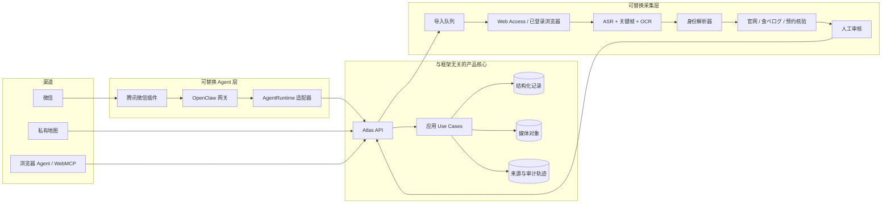
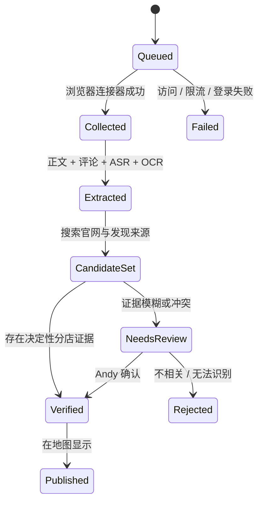

# Japan Atlas 架构 v0.3

状态：有效设计
最后更新：2026-09-06
决策负责人：Andy Zhou

## 1. 架构意图

Japan Atlas 是一个拥有多个可替换入口的产品。地图、微信、WebMCP 与未来 CLI 必须调用同一套应用操作，并读取相同的持久化记录。Agent 是产品核心的客户端，而不是产品记忆的所有者。

设计采用两种互补模式：

- **Ports and Adapters（端口与适配器）**用于整个系统，使 Agent 运行时、社交平台采集器、地图服务商与存储可以独立替换。
- **网页边界上的 MVVM**，让 React 组件负责渲染状态，而 ViewModel 负责搜索、选择、定位、编辑、导入任务与 Journal 操作。

## 2. 逻辑拓扑



## 3. 当前实现边界

私有网页应用目前提供了一条真实但仍在过渡期的纵向切片：

- 经来源核验的初始记录；
- 查询与编辑条目的 API 端点；
- 持久化的导入任务、PlaceAssessment 与可重复 Visit；
- 浏览器定位与按距离排序；
- 交互式多标记地图、可折叠列表、结构化个人状态筛选，以及确定性部分／标签搜索；
- WebMCP 工具层通过同一套 ViewModel action 提供编辑、偏好、评分、Visit、删除、导入排队与附近查找；
- 用于持久化结构化状态的 D1 schema 与 migration。

以下能力被明确视为尚未完成：

- 在本地 collector worker 接入前，Web Access 既不能创建也不能消费任务；
- OpenClaw 与腾讯微信插件尚未部署；
- 图片／视频上传与抽取媒体需要对象存储；
- 浏览器 WebMCP 的只读契约已在部署产品上验证；v2 写入契约仍待实现；
- Sites 的 owner-only 访问边界适合私有网页 UI，但 24/7 OpenClaw 服务可能需要独立的已鉴权 API edge。

## 4. 代码依赖方向

```text
React Views
  -> Atlas ViewModel
    -> 浏览器 API Client
      -> Route Handlers
        -> Atlas Store Port / D1 Adapter
          -> D1

Verified Catalog
  -> 服务端 Repository Merge
  -> 永不依赖 React、OpenClaw 或 Web Access

WebMCP Adapter
  -> 调用 ViewModel Actions
  -> 永不写入只存在于浏览器的影子状态
```

当前实现位置：

| 层 | 职责 | 位置 |
|---|---|---|
| 领域契约 | 地点、预约、活动、导入、评价与 Visit 类型 | `apps/web/features/atlas/model.ts` |
| 已核验初始数据 | 仅包含经真实来源核验的记录 | `apps/web/features/atlas/verified-items.ts` |
| View | 地图、过渡 Inbox／Journal、详情与编辑表单 | `apps/web/features/atlas/atlas-screen.tsx` |
| 地图适配器 | Leaflet 标记、选择、平移／缩放、边界 | `apps/web/features/atlas/atlas-map.tsx` |
| 搜索策略 | 规范化与确定性模糊／标签匹配 | `apps/web/features/atlas/search.ts` |
| ViewModel | UI 状态与 use-case 编排 | `apps/web/features/atlas/use-atlas-view-model.ts` |
| 浏览器适配器 | HTTP 调用 | `apps/web/features/atlas/atlas-api-client.ts` |
| Agent 适配器 | 浏览器 WebMCP 工具注册 | `apps/web/features/atlas/use-atlas-webmcp.ts` |
| 服务端适配器 | D1 读写与 catalog 合并 | `apps/web/lib/server/atlas-store.ts` |
| 交付层 | Item、Inbox、Journal HTTP 路由 | `apps/web/app/api/**` |
| 持久化 | Schema 与不可变 migration | `apps/web/db`、`apps/web/drizzle` |

`atlas-screen.tsx` 目前包含几个过渡期视图组件。选定一个布局分支后，把选中地点卡、集合抽屉、筛选器与 Visit 时间线拆分为职责明确的视图模块。这属于可维护性重构，不应成为让每个布局分支复制 ViewModel 或 API 逻辑的理由。

添加 OpenClaw 前，下一步重构应把服务端 store 接口移动到 application package。这样可以防止微信适配器直接导入 React 或 D1。

## 5. 产品记录

### AtlasItem

规范的地点／活动／建筑身份，包含日文优先展示名称、坐标、地址、分类、个人状态与核验状态。

### Source assertion（来源断言）

所有从外部得出的事实都必须保留 URL、来源角色、观察时间以及最终的抽取证据。当前初始记录把链接直接存放在条目内；采集里程碑会将它们规范化为 assertion。

### TabelogSnapshot

保存观察到的评分、评论数、URL 与核验日期。评分是快照，不是永恒事实。UI 必须显示来源与核验日期。

### ReservationSnapshot

分别存储：

- 是否可以预约或必须预约；
- 预约渠道与链接；
- 通常提前多久放出可预约名额；
- 放号说明与例外情况；
- 最近核验时间。

实时余位不会作为永久事实缓存。当 Andy 请求预约，或预约放号提醒到期时，Agent 必须重新检查预约页面。

### ImportJob

处理创作者主页、频道、帖子或平台 ID 的持久化请求。状态为 `queued`、`collecting`、`needs_review`、`completed` 和 `failed`。任务存储数量与诊断状态，但绝不存储社交账号 Cookie。

### PlaceAssessment

每个 Atlas 条目有一份可选、持久的个人评分与长期总结。没有评分时为 `NULL`，而不是零。收藏／规划状态与是否存在 Visit 相互独立。

### Visit

可追加的到访日期和可选备注。到访序号、次数、最近到访及去过／没去过状态都按条目推导。Visit 绝不复制 Atlas 条目，也不拥有该地点的总体评分。

### MediaAsset / VisitMedia

照片二进制存放在对象存储；D1 保留元数据、内容哈希、说明文字、显示顺序，以及 Visit／Item 关联。网页与 Agent 上传都使用同一个 finalize-and-attach 操作。

## 6.1 界面归属

微信是主要指令与采集入口。私有地图是主要读取、空间整理与记忆入口。地图显示选中地点的统一评价、Visit 时间线与媒体；有歧义的采集证据通过上下文深链接打开，而不要求永久保留 Inbox 入口。

现有 Inbox 与 Journal 路由仅作为过渡备用入口保留，直到微信适配器拥有等价写入操作。更早移除它们会导致产品失去可用写入路径。

## 6.2 交互适配器与写入路径

地图 View 依赖 `AtlasMapAdapter`，而不直接依赖 Leaflet。Leaflet adapter 负责地图实例、注入式瓦片供应商配置、按 key 对账标记、选择、尺寸更新与销毁。今后的供应商或地图引擎实验必须保留这一边界，不得修改 ViewModel 或 Agent 契约。

Journal 新增遵循同一条命令路径：View -> ViewModel 乐观 mutation -> HTTP client -> route 验证 -> 定向地点解析 -> D1 原子批次。客户端 mutation UUID 成为 Visit 主键，因此同一命令可以安全重试而不重复。Visit 修改／删除也由网页 UI 与浏览器 Agent 工具复用同一个 ViewModel 与 HTTP route。

## 6. 采集与身份解析链路



餐厅身份识别的证据优先级：

1. 精确日文名称、地址、电话、预约页面或分店专属 URL；
2. 可读的招牌／菜单／店面 OCR；
3. 创作者正文或评论披露；
4. 菜单／地址／地标组合与搜索候选匹配；
5. 只依赖视觉相似度；它只能提出候选，不能自动确认。

90% 目标指自动确认结果中的精确分店 precision（准确率）。系统可以选择不下结论。有歧义的记录必须进入 Inbox 审核，不得静默进入可信地图。

## 7. Agent 契约

应用操作保持范围明确且可审计：

| 操作 | 读／写 | 确认方式 |
|---|---|---|
| `list_atlas_items` / `find_nearby` | 读 | 无 |
| `get_item_details` | 读 | 无 |
| `queue_creator_import` | 写入任务 | 显示回执 |
| `update_atlas_item` | 写入个人字段 | 仅使用用户认可的输入 |
| `create_visit` | 写入包含可选备注的 Visit | 显示 Visit 回执 |
| `update_visit` | 修正 Visit 日期／笔记与可选持久评分 | 显示保存回执 |
| `delete_visit` | 删除一个 Visit 并重新计算去过状态 | 明确确认 |
| `set_personal_rating` | upsert 一个可空的地点评分 | 显示旧值／新值 |
| `attach_visit_media` | 存储／关联照片与说明 | 显示附件回执 |
| `search_atlas` / `recommend_places` | 读取并排序 | 展示实际应用的筛选条件 |
| `propose_identity` | 写入待审核候选 | 低于阈值时绝不自动发布 |
| `confirm_identity` | 提升为 verified | 有歧义时必须人工明确确认 |

OpenClaw、Hermes、Pi 或其他运行时实现 `AgentRuntime`，并把聊天消息映射到这些操作。任何运行时都不得直接写表。

## 8. 安全与部署分离

- 地图是私有的，目前使用 Sites owner-only 访问边界。
- 网页结构化状态存放在 D1；照片／视频使用 R2 或同类存储，D1 保留说明文字与关联关系。
- 社交平台登录态保留在独立本地浏览器 profile。Cookie 绝不上传到云数据库或 Agent prompt。
- 采集器按需运行并受限流控制。由于自动浏览可能触发平台限制，优先使用社交平台小号。
- 只有微信 PoC 通过后，才可以在小型云实例上运行 24/7 消息网关。目前的网页切片不需要 VPS。
- 外部 Agent 调用在部署前需要范围受限的 API 凭据、请求签名、幂等键、审计事件与逐工具授权。

## 9. Harness 选型

将 OpenClaw 保留为第一个微信候选，因为腾讯维护 `openclaw-weixin` 插件，且它支持消息／媒体。在选择基础设施前，锁定兼容版本并测试主账号私聊流程。

根据渠道可靠性、工具执行、故障恢复、安全、维护成本、延迟和费用比较不同运行时。餐厅识别质量属于采集／证据链路，不应被用来选择 harness。

## 10. 当前架构风险

| 风险 | 缓解措施 |
|---|---|
| 社交平台布局／登录变化 | 可替换采集器、隔离浏览器 profile、人工分享备用方式 |
| 识别错餐厅分店 | 证据账本、分店 key、允许放弃判断、审核队列 |
| 评分／营业时间／预约规则过期 | 核验时间戳、逐字段新鲜度、执行操作前实时复查 |
| Agent 幻觉写入 | 类型化 API、验证、审核状态、审计事件 |
| Sites 私有鉴权不适合云端 Bot | PoC 后使用独立的签名服务 API 或私有隧道 |
| 框架锁定 | Agent 与采集器通过适配器调用产品 use cases |
