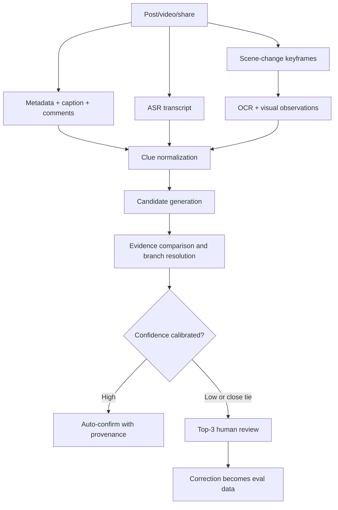

# Data Ingestion and Place Identity Resolution

Status: proposed
Last updated: 2026-09-05

## 1. Accuracy promise

The product should not claim that every ambiguous video can be identified with
90% accuracy. A useful and measurable promise is:

> Among places the system confirms automatically, at least 90% have the correct
> canonical venue and branch. When confidence is insufficient, the system
> abstains and asks Andy to choose from up to three candidates.

This separates **precision** from **coverage**. It is acceptable to auto-confirm
only 50–70% of difficult items at first if the remaining items are routed to a
fast review queue. Silently saving the wrong branch is worse than asking once.

## 2. Source strategy

### Reliable default: share-to-inbox

Andy can forward a URL, share card, screenshot, image, saved video, text, or
voice note. The system acknowledges immediately and never loses the source just
because extraction fails.

### Optional batch discovery

For creator archives and saved collections, use a user-triggered connector in a
dedicated logged-in browser profile. The connector returns a normalized
manifest; it does not write places directly.

`web-access` is a reasonable first experimental connector because it can use a
logged-in browser, but it is not a core dependency. A Playwright/CDP connector
is not magically safer or more stable—it uses the same fragile webpage surface.
Both must be replaceable and rate-limited.

There is currently no suitable stable official API for bulk personal ingestion
of arbitrary Xiaohongshu or Bilibili creator history. YouTube's official API can
list public metadata, but its official captions download method requires the
authenticated user to have permission to edit the video. Therefore every source
needs graceful fallbacks rather than an “official API solves it” assumption.

### Initial discovery seeds

- Xiaohongshu architecture/light food/events: `漫游东京_tokyotrip`, Rednote ID
  `101943310`;
- Xiaohongshu food: `在日本摸鱼的小超人`, Rednote ID `274834935`;
- Bilibili: `Piggy豚豚酱`, UID `697821`;
- later: Andy's saved YouTube links/channels and X bookmarks.

The initial archive job should not deeply transcribe every historical video.
Use two passes:

1. **Discovery pass:** enumerate posts, capture URL/title/date/description,
   classify relevance, and detect likely Tokyo place/event mentions cheaply.
2. **Enrichment pass:** only selected or likely-relevant items receive audio,
   frame, OCR, identity, and reservation analysis.

This lets Andy filter an overview before expensive processing.

## 3. Normalized evidence manifest

Every connector should emit the same contract:

```json
{
  "source_url": "https://...",
  "platform": "xiaohongshu",
  "creator": {"display_name": "...", "platform_id": "..."},
  "published_at": null,
  "captured_at": "...",
  "title": "...",
  "description": "...",
  "comments": [],
  "media": [],
  "transcript_segments": [],
  "frame_observations": [],
  "extraction_method": "shared-link|browser|upload|manual",
  "rights": {"store_original": false},
  "connector_version": "..."
}
```

Derived claims always point back to evidence locations: text spans, timestamps,
frame IDs, or URLs. When licensing is unclear, store the source URL, hashes, and
compact derived observations rather than a permanent copy of the whole video.

## 4. Video-to-place pipeline



### A. Extract independent clues

- explicit Japanese/English/Chinese venue names and aliases;
- street address fragments, postal codes, building/floor, station, ward, exit;
- phone number, reservation URL, logo, storefront text, receipt;
- menu item names, prices, plate design, chef/owner name;
- interior/exterior appearance and neighboring businesses;
- spoken directions such as “three minutes from Ebisu Station”;
- creator caption, pinned comment, replies asking for the shop name;
- publication date, which helps distinguish moved/closed branches.

ASR and OCR should retain timestamps and raw text. A model-generated summary by
itself is not sufficient evidence.

### B. Generate candidates

Use several query forms over Tabelog, official search/map results, and approved
place providers:

- normalized name/alias + city;
- address/building + cuisine;
- station + signature dish + price;
- phone number or booking URL;
- menu phrase in Japanese;
- image/logo comparison only as supporting evidence.

Candidate generation should optimize top-three recall; the later resolver owns
precision.

### C. Resolve the canonical venue and branch

Score evidence by reliability, not just count. Example strength order:

1. exact phone/address/booking URL;
2. exact Japanese name plus matching branch/building;
3. storefront/menu/price plus matching neighborhood;
4. cuisine/interior/nearby station;
5. broad visual similarity or creator habit.

An initial auto-confirm policy can require:

- top candidate calibrated probability above a threshold determined by evals;
- a sufficient margin over candidate two;
- at least two independent strong signals, or one unique identifier;
- no hard contradiction in address, branch, price, or date;
- a source that was active at the video's publication time.

Do not hard-code `0.90` as a model self-reported confidence. Calibrate the
threshold from labeled outcomes; model confidence text is not a probability.

### D. Human review card

For uncertain cases, show:

- source video at the relevant timestamp or frame;
- the clues the system used;
- up to three candidate cards with name, branch, map, and matching/conflicting
  evidence;
- `None / needs research` and manual search;
- one-tap confirmation.

The review target is under 30 seconds for a normal ambiguous item. Corrections
become labeled examples, including creator-specific patterns.

## 5. Reservation enrichment

Reservation rules are time-sensitive claims, not static place attributes. Store
each claim with its source, effective date if known, fetch time, and confidence.

Preferred verification order:

1. restaurant/venue official website and official booking link;
2. the linked booking service, for example TableCheck, Omakase, or another
   venue-authorized system;
3. Tabelog booking/status information;
4. recent official social account posts;
5. third-party reports or X posts only as leads, clearly marked unconfirmed.

Normalize into:

- walk-in accepted/unknown;
- phone/web/lottery/member/invite mode;
- earliest and latest booking horizon;
- release rule with Japan timezone;
- party-size and seating constraints;
- deposit/prepayment/cancellation rules;
- language/card requirements;
- next calculated opening time;
- `verified_at`, source URL, confidence, and stale-after policy.

Before making a recommendation, refresh high-impact stale facts. The agent may
prepare a booking link and instructions but v1 does not submit a reservation,
payment, cancellation, or restaurant message without explicit confirmation.

## 6. Cost-controlled model cascade

Use the smallest adequate step first:

1. deterministic URL/platform parsing and metadata;
2. inexpensive text classification and extraction;
3. ASR plus sparse scene-change frames;
4. stronger multimodal reasoning only for ambiguous selected items;
5. external search/verification only after clues exist;
6. human review when evidence remains weak.

Cache immutable evidence by content hash. Prompt/model changes can rerun the
resolver without fetching or processing the source again.

## 7. Connector safety and operations

- use a secondary account and dedicated browser profile where practical;
- never automate likes, follows, comments, or posting;
- rate-limit and add random human-scale spacing for user-triggered discovery;
- stop when challenged, logged out, or rate-limited;
- keep the local browser-control service short-lived;
- do not expose its port outside loopback;
- remember that `web-access` currently exposes unauthenticated local control and
  arbitrary page JavaScript while active;
- never send browser cookies to the cloud agent;
- record connector versions and failures for reproducibility;
- provide CSV/JSON manual import so a connector outage cannot lock the product.

## 8. Initial experiment

Before bulk collecting hundreds of videos, label and process 30 items:

- 10 explicit-name/easy items;
- 10 address/menu/medium items;
- 10 inference-heavy/hard items;
- balanced across the three seed creators where available.

Compare metadata-only, metadata+ASR/OCR, and full candidate verification. This
will reveal whether the expensive pipeline materially improves exact branch
precision and which content source deserves the first full importer.

## 9. Reference

- YouTube captions download permissions: https://developers.google.com/youtube/v3/docs/captions/download
- `web-access`: https://github.com/eze-is/web-access
