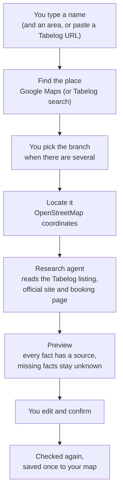
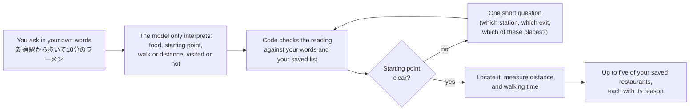

# Features

How Place Atlas 0.1.0 works in detail. The [README](../README.md) has the overview and screenshots.

## Add a restaurant

| | How it works |
| --- | --- |
| **What you type** | A name as you remember it, optionally with an area or branch (`一蘭 渋谷`, `Afuri Ebisu`), or a pasted Tabelog listing URL. Japanese, English and mixed input work; dictated text is tolerated. |
| **Finding the place** | With a Google Places key, the name is checked against Google Maps and up to three Japanese candidates are shown with their address. Without one, Tabelog listings are found through web search. A pasted Tabelog URL is read directly. |
| **What is added** | Name, address and map coordinates; Tabelog score and listing link; cuisine categories and signature dishes; opening hours and closing days; the dine-in reservation rule (reservable, required, not taken) with the booking link and how far ahead bookings open; the official website; a Google rating as a dated reference (optional). |
| **How facts are checked** | The agent works within a fixed budget (two searches, three model turns, 35 seconds). A fact is kept only when it is quoted from a source about the same branch: the same name, street number, postcode and town, or the same map pin. A takeaway note never decides the dine-in rule. Anything it cannot prove stays *unknown* and you can fill it in. |
| **Review before saving** | The preview shows every field with its source. You can edit the name, address, coordinates, notes and any fact, and see possible duplicates of places you already saved. |
| **Saving** | Confirm re-checks the place, its location and its sources. If something changed, you see the new preview first. A restaurant without a name, address and coordinates is never saved, and pressing Confirm twice saves it once. |
| **When something fails** | Each warning names what happened: Google or search refused or unavailable, Tabelog refused the read, no listing matched this branch, or research timed out. Your selection is kept, nothing is invented, and you can retry, paste the Tabelog URL, or complete the fields yourself. Without a model key, Add still finds and locates the place. |
| **From other tools** | An external agent (for example a chat bot) can add restaurants through the Add Agent API with its own token (`GET /api/agent/capabilities` describes it). It cannot set your personal fields. |

## Recommend from your own list

| | How it works |
| --- | --- |
| **What you can ask** | A dish or cuisine (ramen, sushi, French, 焼肉…), a starting point (an area, a station, an address, a saved restaurant or a Google Maps link), a walking time (*within 10 minutes*), *near me*, places you have or haven't visited, and walk-in only (*no reservation*). |
| **Where answers come from** | Only your saved restaurants. The model never invents a restaurant, a location or a route; a cuisine you have not saved returns no results instead of something unrelated. |
| **Distances and times** | Stations and addresses are geocoded and walking times come from Google through the optional route sidecar, shown with their source and time. Otherwise distance is straight-line. |
| **Clarifying questions** | An unclear starting point gets one short question: an exact point within a broad area, which of several matching places, or a choice of located candidates. |
| **Not supported yet** | Train and driving times (Google has no train routes in Japan; you are told so instead of getting a guess), and conditions on scores such as *Tabelog 3.5 or higher* (planned, see [status](status.md)). |

## Browse, journal and keep your own notes

| | What you get |
| --- | --- |
| **Map** | Every saved restaurant on an OpenStreetMap map, with a side list you can search by name, filter by visited/not visited and favorites, and sort by date added or score. |
| **Table** | All restaurants with cuisine, prefecture, area, Tabelog / Google / your scores, visits and reservation rule; filter by cuisine and prefecture, search, and sort by last visit, your rating, Tabelog, Google or name. |
| **Restaurant details** | Tabelog score and link, opening hours, closing days, reservation rule and booking link, official site, dishes, address and map, with each fact's source. |
| **Your notes** | A personal score from 0 to 10, a favorite (♡), visited or not, and an overall comment, all yours and editable any time. The Owner can also correct the name and description, refresh the Google rating, or delete a restaurant with its visits and photos. |
| **Journal** | Record each visit with a date, an optional note and score, and photos or videos. Browse all visits and sort or filter them by restaurant. |
| **Photos and videos** | JPEG/PNG/WebP/GIF up to 8 MB and MP4/WebM up to 50 MB, checked by file signature. Add a caption to any photo, browse them in a viewer, delete them individually. Uploads are safe to retry: a retry never duplicates or overwrites a file. |
| **Visitors and Owner** | Anyone with the link can browse published restaurants, visits and photos. Only the Owner (one password per deployment) can add, edit, upload or ask Recommend, which spend your provider quota. |
| **Your keys** | Every deployment uses its owner's own keys. The Owner saves a DeepSeek or OpenAI key on the site; it is encrypted at rest and never sent back to the browser. Monthly caps protect paid Google calls. |
