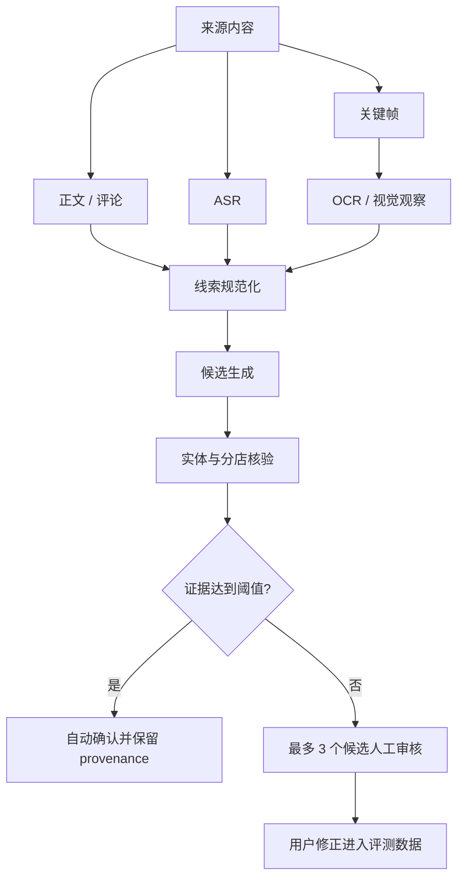

# 数据采集、实体识别与评测

状态：有效设计基线
最后更新：2026-09-09

## 1. 目标与准确率承诺

采集系统把分享链接、图片、视频、文字或指定创作者内容转换为带证据的地点／活动候选。目标不是对所有模糊内容都给答案，而是：

> 在系统自动确认的结果中，至少 90% 必须是正确的规范地点和精确分店；证据不足时主动放弃判断，并让用户从最多三个候选中确认。

精确率与覆盖率必须同时报告。少确认一些，也好过静默污染可信地图。

## 2. 输入与两阶段策略

### 可靠默认入口

用户可以分享 URL、分享卡片、截图、图片、视频、文字或语音。系统应立即保存来源并回执；解析失败不能导致原始请求丢失。

### 可选批量发现

创作者历史和收藏集合通过用户触发的可替换 connector 获取。登录浏览器只生成规范化 evidence manifest，不直接创建可信地点。

`web-access` 可以是首个实验 connector，但不是领域核心依赖。所有平台连接器都必须可替换、限速、可暂停，并提供手动 JSON／CSV 导入退路。

批量任务分两遍：

1. **Discovery**：枚举帖子，保存 URL、标题、时间、正文和低成本相关性判断。
2. **Enrichment**：只对用户选择或高相关内容运行评论提取、ASR、关键帧、OCR、多模态推理和外部核验。

不得一开始深度处理全部历史内容。

## 3. Evidence manifest

每个 connector 输出同一版本化契约，至少包含：

```json
{
  "sourceUrl": "https://...",
  "platform": "...",
  "creatorRef": "private-config-key",
  "publishedAt": null,
  "capturedAt": "...",
  "title": "...",
  "description": "...",
  "comments": [],
  "transcriptSegments": [],
  "frameObservations": [],
  "extractionMethod": "shared-link|browser|upload|manual",
  "connectorVersion": "...",
  "rights": { "storeOriginal": false }
}
```

所有派生结论必须回指文本片段、时间戳、frame 或 URL。ASR／OCR 原文和位置应保留；模型摘要不能替代证据。

对第三方内容，默认只长期保存 URL、hash 和必要的派生观察，不复制大段评论或完整媒体。该限制不适用于用户自己的私有 Journal 照片。

## 4. 视频到地点的解析流程



### 独立线索

- 日／中／英文店名、别名、招牌和 Logo；
- 地址、邮编、建筑／楼层、车站、出口和步行描述；
- 电话、官网、预约 URL、收据；
- 菜名、价格、菜单、餐具、厨师或店主信息；
- 外观、室内和相邻商户；
- 正文、置顶评论、作者回复和发布时间。

### 证据优先级

1. 完整电话、地址、官方预约 URL 等唯一标识；
2. 日文名称与分店／建筑完全匹配；
3. 招牌、菜单、价格和街区组合匹配；
4. 菜系、室内和附近车站；
5. 仅视觉相似，只能支持候选，不能单独自动确认。

自动确认需要足够的候选领先幅度、至少两个独立强信号或一个唯一标识，并且不存在地址、分店、价格或日期硬冲突。模型自报的“90% confidence”不是校准概率。

### 人工审核

审核卡展示来源时间点／关键帧、采用的线索、候选匹配与冲突证据，以及 `None / needs research`。正常歧义项的目标中位处理时间不超过 30 秒。

## 5. 预约与活动信息

预约和活动信息是有时效的 claim，不是静态字段。每项至少保存来源、核验时间、置信度和 stale policy；适用时保存生效日期。

核验优先级：

1. 场所官网和官方预约链接；
2. 场所授权的预约服务；
3. 食べログ等结构化来源；
4. 官方社交账号；
5. 第三方帖子只作为待确认线索。

餐厅预约建议规范化为：walk-in、电话／网页／抽签／会员模式、预约开放范围、JST 放号规则、人数与座位限制、预付／取消规则、语言／支付要求和下一次可预约时间。

Agent 可以准备链接和说明，但 v1 未经明确确认不得代为预约、付款、取消或联系商家。

## 6. Connector 安全

- 使用独立浏览器 profile 和小号；
- 不自动点赞、关注、评论或发布内容；
- 控制批次和频率，遇到验证码、登出、限流或挑战立即停止；
- 浏览器控制仅绑定 loopback，Cookie 不上传云端；
- loopback 不是完整鉴权：同机不可信进程仍可能调用控制服务执行页面脚本，因此高权限浏览器控制必须短时启停，并与常驻 Agent 隔离权限和凭证；
- 记录 connector 版本、失败和来源 hash，保证可重放；
- 对网页文本、评论、OCR、文件名和模型输出统一按不可信输入处理；
- connector 只提交 manifest，不能绕过应用 API 写入生产表。

## 7. 评测分层

必须分开两套评测：

- **领域评测**：采集、提取、精确地点／分店、预约事实和推荐质量。
- **Runtime 评测**：微信消息、工具调用、状态、重试、恢复、权限、运维和成本。

更换 OpenClaw、Hermes、Pi 或模型不会自动解决实体证据问题；同样，改进 OCR 不代表渠道能够可靠重连。

### 领域初始目标

| 指标 | 初始目标 |
|---|---:|
| 分享／上传采集成功率 | ≥ 90% |
| 地点／活动 mention recall | ≥ 95% |
| 自动确认精确分店 precision | ≥ 90%，目标 95% |
| Top-3 candidate recall | ≥ 95%（可判定样本） |
| 正确 abstention | ≥ 95% |
| 高影响预约字段准确率 | ≥ 95% |
| 身份／预约 provenance 完整率 | 100% |
| 普通人工审核中位时间 | ≤ 30 秒 |

先用少量 smoke cases 验证链路。采集器稳定后再运行约 30 条校准集，并在 pipeline 能被指标真正指导时扩展到约 150 条，保留不可调参的 holdout。具体账号和样本引用只进入私有配置或 Issue，不写入核心文档。

### Runtime 固定场景

至少覆盖：

- 文本、URL、单图／多图、语音、位置和不支持的附件；
- 重复投递、超时、限流、错误输出、重启和 worker retry；
- 未授权发送者、网页／OCR prompt injection 和越权工具请求；
- 未确认的预约／付款／删除；
- 登录丢失、二维码重连、时区边界和七天 soak；
- 备份恢复、版本升级和回滚。

### 推荐评测

推荐先执行确定性硬筛选，再由模型排序。自动检查不得违反距离、时间、到访、预约等硬约束，并且必须披露 stale／unknown 字段。用户以 `useful`、`acceptable`、`bad` 评价 shortlist；优化目标是决策效率，不是文案华丽程度。

## 8. Harness 选择方法

1. 先实现一个共享 `AgentRuntime` 契约和 mocked tool suite。
2. 用同一组消息、模型和工具跑首选候选。
3. 比较工具正确率、澄清、图片处理、恢复、安全、维护时间、延迟和月成本。
4. 只有首选未达门槛或 challenger 有明显收益时才实现第二个薄 adapter。
5. 通过本项目证据更新决策登记册，不根据单次 demo 印象切换。

评测 fixture、runner 和结果格式必须 vendor-neutral，并记录代码、connector、prompt、model、tool schema、来源 hash、成本与失败，避免被某个托管评测平台锁定。
